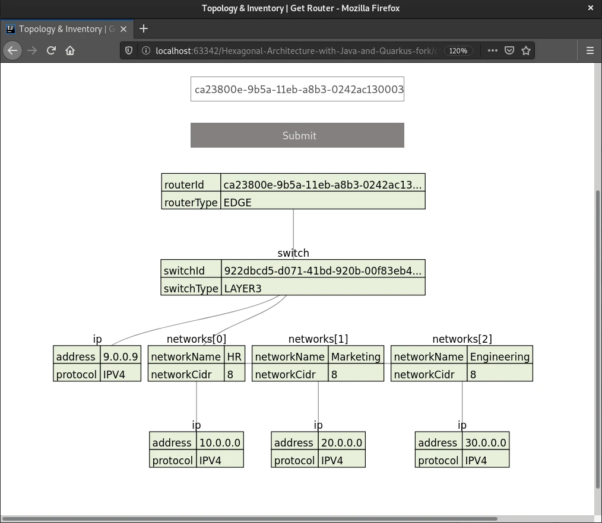

# Case Study: Telco Network Topology Inventory

In *Designing Hexagonal Architecture with Java*, Davi Vieira develops a full-scale reference application: a **Network and Topology Inventory Management System** for a telecommunications provider. This case study analyzes how the core domain entities, specifications, and multi-module layout work together in practice.



---

## 1. The Business Domain Problem

A telecommunications company maintains thousands of networking devices across wide geographic areas. To automate routing and avoid outages, the inventory software must enforce strict operational constraints:
1. **Core Routers:** Backbones connecting regional networks. They support up to 8 high-bandwidth CIDR networks and cannot be directly attached to customer edge endpoints.
2. **Edge Routers:** Gateways deployed at the boundary between customer premises and core networks.
3. **Switches:** Hardware devices managing local area networks (LANs) connected to routers.
4. **Network Assignment Rules:** A network cannot be added to a router if its protocol (IPv4 vs. IPv6) is incompatible or if the router's interface capacity is exceeded.

---

## 2. Domain Modeling with Specification Invariants

Instead of hardcoding checks into procedural service methods, the domain uses the **Specification Pattern**:

```java
public class NetworkAmountSpec implements Specification<Router> {
    public static final int MAXIMUM_ALLOWED_NETWORKS = 8;

    @Override
    public boolean isSatisfiedBy(Router router) {
        return router.getNetworks().size() < MAXIMUM_ALLOWED_NETWORKS;
    }
}
```

```java
public class EmptyNetworkSpec implements Specification<Router> {
    @Override
    public boolean isSatisfiedBy(Router router) {
        return router.getNetworks().isEmpty();
    }
}
```

When a network is added, the `CoreRouter` entity evaluates its specifications before altering state:

```java
public class CoreRouter extends Router {
    // Invariant check executed directly within domain entity
    @Override
    public void addNetworkToRouter(Network network) {
        var amountSpec = new NetworkAmountSpec();
        var protocolSpec = new CompatibleProtocolSpec(this.getIp().getProtocol());

        if (!amountSpec.and(protocolSpec).isSatisfiedBy(this)) {
            throw new IllegalArgumentException("Core router network capacity or protocol constraint violated");
        }
        this.networks.add(network);
    }
}
```

---

## 3. The End-to-End Hexagonal Trace

```text
Actor (Network Admin via cURL)
   | POST /routers/9b1d.../networks
   v
[ REST Input Adapter (RouterResource) ]
   | Validates HTTP request, builds Network Value Object
   v
[ Input Port (RouterManagementInputPort) ]
   | Calls outputPort.retrieveRouter(id)
   v
[ Output Port Interface (RouterManagementOutputPort) ]
   ^
   | Implemented by
[ Output Adapter (RouterMySQLAdapter) ]
   | Fetches RouterData from MySQL via Panache, maps to CoreRouter entity
   v
[ Domain Entity (CoreRouter) ]
   | Runs NetworkAmountSpec & CompatibleProtocolSpec
   | Appends Network to internal collection
   v
[ Output Adapter (RouterMySQLAdapter) ]
   | Persists updated state back to MySQL
   v
[ HTTP 200 OK returned with updated topology ]
```

By keeping the business rules inside `CoreRouter` and `NetworkAmountSpec`, the domain behavior remains 100% testable in unit tests without starting MySQL or Quarkus.
