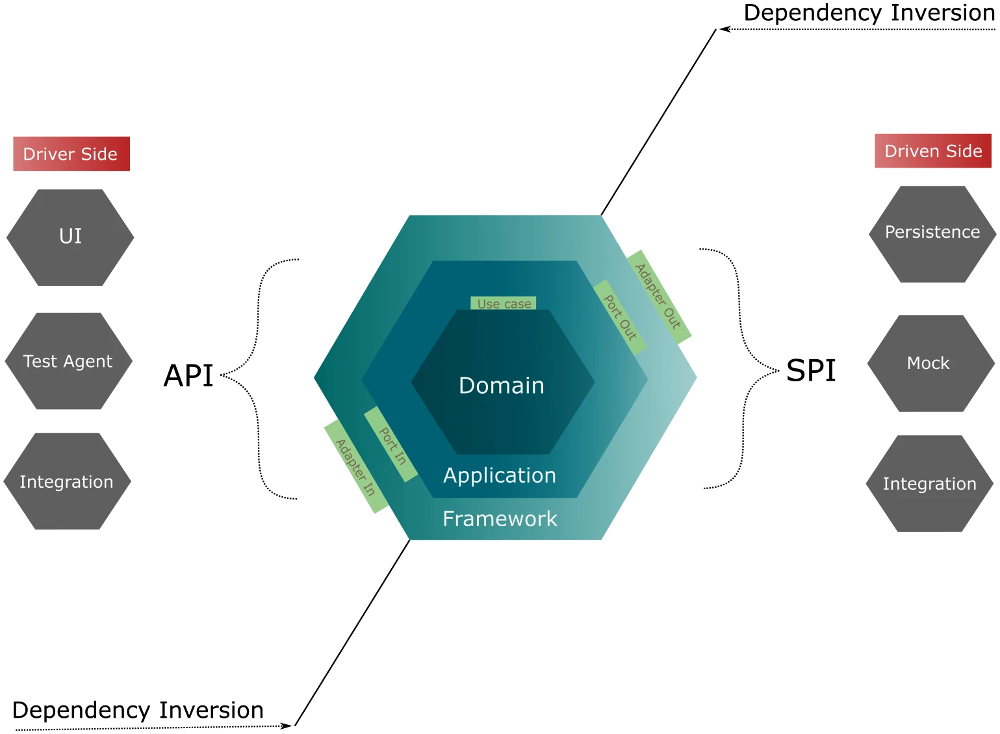
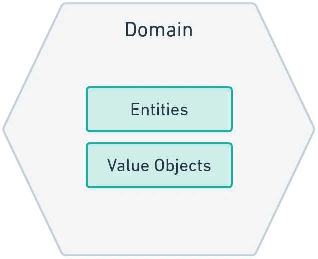
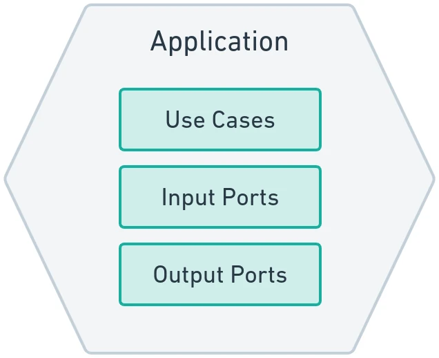
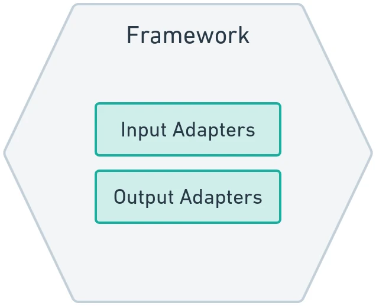

# Core Principles & The Three Hexagons

Software systems inevitably face changing business requirements, evolving technologies, and shifting architectural priorities. Without deliberate, enforceable architectural boundaries, systems succumb to **architectural erosion**—a state where business rules become inextricably tangled with web frameworks, databases, and third-party APIs.

In *Designing Hexagonal Architecture with Java*, Davi Vieira explores how **Hexagonal Architecture** (originally formulated by Alistair Cockburn as **Ports and Adapters**) solves this structural breakdown. By establishing strict physical and conceptual perimeters between business logic and technical infrastructure, hexagonal architecture ensures that your software remains maintainable, testable, and tolerant to change over decades.



---

## 1. The Vicious Cycle of Technical Debt

In traditional layered architectures (commonly composed of Presentation, Business/Service, and Data Access layers), components typically depend on the layers directly below them:

```text
Traditional Layered Architecture (Leaky & Fragile):
+-------------------------------------------------------+
|                 UI / REST Controllers                 |
+-------------------------------------------------------+
                           |  (direct method call)
                           v
+-------------------------------------------------------+
|         Business Services (Coupled to ORM/DB)         |
+-------------------------------------------------------+
                           |  (compile-time dependency)
                           v
+-------------------------------------------------------+
|       Data Access Layer (JPA Entities, SQL Drivers)   |
+-------------------------------------------------------+
```

Although layered architecture appears intuitive, it suffers from several critical flaws in long-lived enterprise applications:

1. **Database-Driven Design:** Developers begin modeling the database schema before considering domain invariants. Business entities become tightly bound to database tables, foreign keys, and ORM decorators (`@Entity`, `@Table`, `@Column`, `@OneToMany`).
2. **Framework Intrusion:** As business classes grow, they become contaminated with framework-specific annotations and runtime contexts (`@Transactional`, `@Autowired`, Jackson `@JsonProperty`).
3. **Impaired Testability:** Unit tests for business rules become difficult or impossible to execute in isolation. Testing a simple calculation requires configuring in-memory databases, spinning up mock application contexts, or handling complex ORM session lifecycles.
4. **Technology Lock-In:** Upgrading a web framework, transitioning from relational SQL to a document store, or exposing features via gRPC requires extensive, risky refactoring across the core business layer.

Hexagonal architecture eradicates this vicious cycle by applying the **Dependency Inversion Principle (DIP)**: high-level business rules must never depend on low-level technological implementation details; both must depend on abstractions.

---

## 2. The Three Concentric Hexagons

Hexagonal Architecture organizes software into three concentric structural hexagons, where control flows across clearly demarcated boundaries:

```text
                       [ THE THREE HEXAGONS ]
+-------------------------------------------------------------------+
|                        FRAMEWORK HEXAGON                          |
|  (REST Controllers, CLI, GraphQL, Database Repositories, Brokers) |
|   +-----------------------------------------------------------+   |
|   |                    APPLICATION HEXAGON                    |   |
|   |     (Use Cases, Input Ports, Output Port Interfaces)      |   |
|   |   +---------------------------------------------------+   |   |
|   |   |                  DOMAIN HEXAGON                   |   |   |
|   |   |  (Pure Entities, Value Objects, Specifications,   |   |   |
|   |   |         Domain Services, Business Invariants)     |   |   |
|   |   +---------------------------------------------------+   |   |
|   +-----------------------------------------------------------+   |
+-------------------------------------------------------------------+
```

### 1. The Domain Hexagon (Inner Core)
The **Domain Hexagon** represents the heart of the software. It models the real-world problem domain using pure Java code (**Plain Old Java Objects - POJOs**).



- **Pure POJOs:** Contains entities, immutable value objects, aggregates, domain events, and specifications.
- **Zero Framework Contamination:** The domain hexagon has zero imports outside `java.base`. It knows nothing about databases, network protocols, JSON parsing, or dependency injection engines.
- **Ubiquitous Language:** Expresses concepts strictly in the shared language of domain experts and software engineers.

### 2. The Application Hexagon (Middle Layer)
The **Application Hexagon** bridges user intent with the domain model. It orchestrates domain objects to carry out business workflows.



- **Use Cases:** Explicit Java interfaces defining the capabilities and features offered by the application (e.g., `RouterManagementUseCase`).
- **Input Ports:** Concrete classes implementing Use Case interfaces. They receive requests from the outside world, coordinate domain entities, and invoke output ports.
- **Output Ports:** Interfaces declared inside the Application Hexagon that abstract access to external systems (such as persistent storage, message queues, or third-party APIs).

### 3. The Framework Hexagon (Outer Layer)
The **Framework Hexagon** encloses all technology-specific mechanisms required to interact with the outside world.



- **Adapters:** Components that translate external technical protocols into pure domain concepts, and vice-versa.
- **Infrastructure Tools:** Houses RESTEasy Reactive, Panache Hibernate, JDBC drivers, Kafka publishers, CLI parsers (Picocli), and Quarkus runtime configurations.

---

## 3. Driving vs. Driven Operations

Hexagonal architecture categorizes all external interactions into two operational vectors: **Driving (Primary)** and **Driven (Secondary)**.

```text
[ Driving Actor ] ---> [ Input Adapter ] ---> [ Input Port ] ---> [ Domain Core ]
 (User / Test / CLI)       (REST / CLI)       (Use Case Impl)     (Pure Entities)
                                                                        |
                                                                        v
[ Driven Actor ]  <--- [ Output Adapter ] <--- [ Output Port ] <--------+
 (Database / Broker)     (Hibernate / Kafka)    (Interface SPI)
```

| Architectural Aspect | Driving (Primary) Operations | Driven (Secondary) Operations |
| :--- | :--- | :--- |
| **Originator** | Outside actor (Web browser, Mobile app, CLI user, Automated test runner, Scheduled job). | Inside the application (A use case needing external data or notifying another system). |
| **Flow of Control** | Outside $\rightarrow$ Inward to Application Hexagon. | Inside $\rightarrow$ Outward to Infrastructure. |
| **Entry Mechanism** | **Input Adapter** calls an **Input Port** interface. | **Input Port** invokes an **Output Port** interface implemented by an **Output Adapter**. |
| **Primary Goal** | Triggers the system to execute a business intent. | Fulfills infrastructure operations required by the business intent. |

---

## 4. Fundamental Architectural Rules

To preserve hexagonal integrity across the lifecycle of a Java project, four fundamental rules must be obeyed:

```text
                  [ ARCHITECTURAL DEPENDENCY RULE ]
              Framework  ===>  Application  ===>  Domain
              (Outer)          (Middle)           (Inner Core)
```

1. **Dependencies Always Point Inward:** The Domain Hexagon never imports from Application or Framework. The Application Hexagon never imports from Framework.
2. **Ports are Contracts Owned by the Application:** Input ports implement Use Case interfaces; Output ports are interfaces defined directly within the Application Hexagon.
3. **Adapters Reside Strictly on the Outside:** Driving adapters invoke Input Ports; Driven adapters implement Output Ports.
4. **Domain Purity is Absolute:** Never permit `@Entity`, `@Table`, `@Id`, `@RestController`, or `@Inject` annotations to leak into Domain Hexagon classes.
