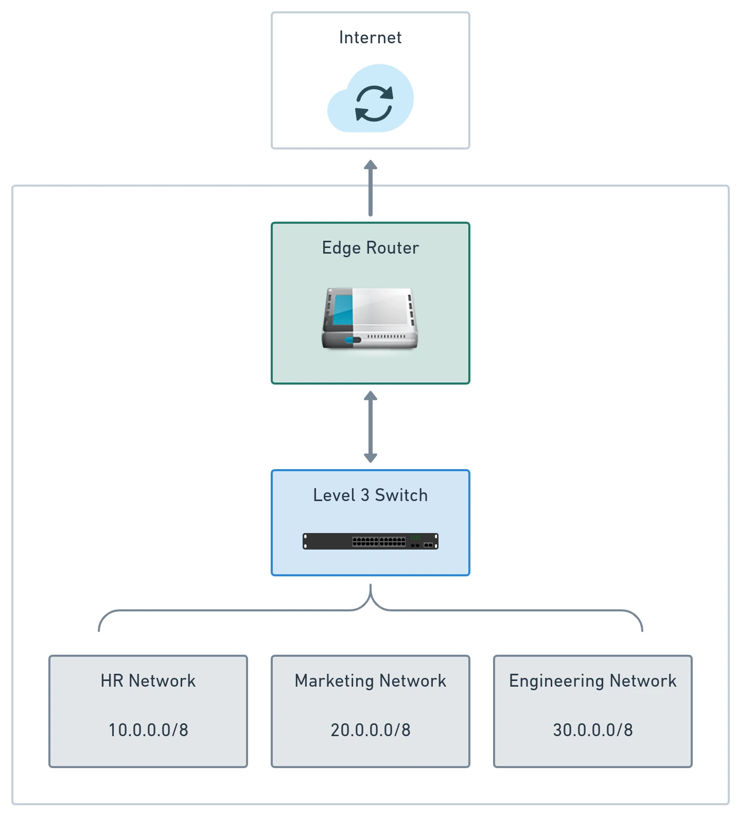

# Domain Hexagon: Entities & Specifications

The **Domain Hexagon** is the architectural epicenter of hexagonal software. It isolates pure business logic from infrastructural volatility. Following Domain-Driven Design (DDD) principles, this layer models the problem domain using Java POJOs, encapsulated business invariants, and the **Specification Pattern**.



---

## 1. Domain Entities: Identity and Invariants

A **Domain Entity** represents an individual concept in the business domain that possesses both a persistent identity and mutable lifecycle state. Unlike anemic data holders that consist merely of public getters and setters, a rich domain entity guards its internal state and enforces business rules through its public methods.

```java
package dev.davivieira.topologyinventory.domain.entity;

import dev.davivieira.topologyinventory.domain.specification.NetworkAmountSpec;
import dev.davivieira.topologyinventory.domain.specification.Specification;
import dev.davivieira.topologyinventory.domain.vo.IP;
import dev.davivieira.topologyinventory.domain.vo.Id;
import dev.davivieira.topologyinventory.domain.vo.Network;
import dev.davivieira.topologyinventory.domain.vo.RouterType;
import java.util.ArrayList;
import java.util.Collections;
import java.util.List;

public abstract class Router {
    protected final Id id;
    protected final RouterType routerType;
    protected IP ip;
    protected List<Network> networks;

    protected Router(Id id, RouterType routerType, IP ip, List<Network> networks) {
        if (id == null || routerType == null || ip == null) {
            throw new IllegalArgumentException("Router core attributes cannot be null");
        }
        this.id = id;
        this.routerType = routerType;
        this.ip = ip;
        this.networks = new ArrayList<>(networks != null ? networks : Collections.emptyList());
    }

    public abstract void addNetworkToRouter(Network network);
    public abstract void removeNetworkFromRouter(Network network);

    public Id getId() { return id; }
    public RouterType getRouterType() { return routerType; }
    public IP getIp() { return ip; }
    public List<Network> getNetworks() { return Collections.unmodifiableList(networks); }
}
```

### Essential Characteristics of Domain Entities:
- **Unique Identity:** Entities are distinguished by an immutable identifier (`Id` containing a UUID), not by their memory address or current attribute values. Two routers with identical IP addresses and network lists remain distinct entities if their `Id` differs.
- **Zero Framework Annotations:** Notice that the class contains no `@Entity`, `@Table`, `@Column`, `@Id`, or Jackson `@JsonProperty` annotations. Persistence and serialization are strictly infrastructure concerns.
- **Unmodifiable Exposures:** Collections returned by getters are wrapped in `Collections.unmodifiableList(...)` or `List.copyOf(...)` to prevent callers from bypassing domain methods to alter state directly.

---

## 2. Value Objects: Expressive & Immutable

**Value Objects (VOs)** represent concepts whose identity is determined entirely by their attribute values. If two value objects have the same values, they are considered equal and interchangeable.

```java
package dev.davivieira.topologyinventory.domain.vo;

import java.util.Objects;
import java.util.regex.Pattern;

public final class IP {
    private static final Pattern IPV4_PATTERN = Pattern.compile(
        "^((25[0-5]|(2[0-4]|1\\d|[1-9]|)\\d)\\.?\\b){4}$"
    );

    private final String address;
    private final Protocol protocol;

    public IP(String address) {
        if (address == null || address.isBlank()) {
            throw new IllegalArgumentException("IP address cannot be null or blank");
        }
        this.address = address.trim();
        if (IPV4_PATTERN.matcher(this.address).matches()) {
            this.protocol = Protocol.IPV4;
        } else if (address.contains(":")) {
            this.protocol = Protocol.IPV6;
        } else {
            throw new IllegalArgumentException("Invalid IP address format: " + address);
        }
    }

    public String getAddress() { return address; }
    public Protocol getProtocol() { return protocol; }

    @Override
    public boolean equals(Object o) {
        if (this == o) return true;
        if (!(o instanceof IP ip)) return false;
        return Objects.equals(address, ip.address) && protocol == ip.protocol;
    }

    @Override
    public int hashCode() {
        return Objects.hash(address, protocol);
    }

    @Override
    public String toString() {
        return address + " (" + protocol + ")";
    }
}
```

### Why Value Objects Matter:
1. **Self-Validating:** Validation occurs in the constructor. Once an `IP` instance exists, it is guaranteed to be syntactically valid everywhere in the codebase.
2. **Immutability:** Value objects have no setters. Once instantiated, their internal state cannot change, eliminating concurrent modification bugs.
3. **Type Safety:** Using `IP` and `RouterId` instead of primitive `String` prevents parameter transposition bugs when calling methods such as `connect(IP source, IP destination)`.

---

## 3. Aggregates and Consistency Boundaries

An **Aggregate** is a cluster of associated domain entities and value objects treated as a single unit for data changes:
- Every aggregate has an **Aggregate Root** (e.g. `Router`).
- External code may hold references only to the aggregate root; it must never directly manipulate internal entities or collections (e.g. the router's internal list of `Network` instances).
- All operations that modify internal state must pass through methods on the aggregate root, ensuring that business invariants are maintained atomically.

```text
+--------------------------------------------------------------+
|                   ROUTER AGGREGATE BOUNDARY                  |
|                                                              |
|   +------------------------------------------------------+   |
|   |             Router (Aggregate Root)                  |   |
|   |  - id: Id                                            |   |
|   |  - ip: IP (Value Object)                             |   |
|   |  - routerType: RouterType (Enum Value Object)        |   |
|   +------------------------------------------------------+   |
|                              |                               |
|                              | 1..* (managed internally)     |
|                              v                               |
|   +------------------------------------------------------+   |
|   |                Network (Value Object)                |   |
|   |  - networkAddress: IP                                |   |
|   |  - networkName: String                               |   |
|   |  - cidr: int                                         |   |
|   +------------------------------------------------------+   |
+--------------------------------------------------------------+
```

---

## 4. The Specification Design Pattern

Complex enterprise applications often contain complex, conditional business rules that should not clutter domain entity methods. The **Specification Pattern** encapsulates business rules into reusable, composable predicate objects.

```text
                  [ SPECIFICATION PATTERN ]
             +----------------------------------+
             |       Specification<T>           |
             +----------------------------------+
             | + isSatisfiedBy(candidate: T)    |
             | + and(other: Specification<T>)   |
             | + or(other: Specification<T>)    |
             | + not()                          |
             +----------------------------------+
                              ^
             +----------------+----------------+
             |                                 |
+--------------------------+     +--------------------------+
|  EmptyNetworkSpec<Router>|     | NetworkAmountSpec<Router>|
+--------------------------+     +--------------------------+
```

### Generic Specification Interface in Pure Java:

```java
package dev.davivieira.topologyinventory.domain.specification;

public interface Specification<T> {
    boolean isSatisfiedBy(T candidate);

    default Specification<T> and(Specification<T> other) {
        return candidate -> this.isSatisfiedBy(candidate) && other.isSatisfiedBy(candidate);
    }

    default Specification<T> or(Specification<T> other) {
        return candidate -> this.isSatisfiedBy(candidate) || other.isSatisfiedBy(candidate);
    }

    default Specification<T> not() {
        return candidate -> !this.isSatisfiedBy(candidate);
    }
}
```

### Concrete Business Rules as Specifications:

```java
package dev.davivieira.topologyinventory.domain.specification;

import dev.davivieira.topologyinventory.domain.entity.Router;

public class NetworkAmountSpec implements Specification<Router> {
    public static final int MAXIMUM_ALLOWED_NETWORKS = 8;

    @Override
    public boolean isSatisfiedBy(Router router) {
        return router.getNetworks().size() < MAXIMUM_ALLOWED_NETWORKS;
    }
}
```

```java
package dev.davivieira.topologyinventory.domain.specification;

import dev.davivieira.topologyinventory.domain.entity.Router;

public class EmptyNetworkSpec implements Specification<Router> {
    @Override
    public boolean isSatisfiedBy(Router router) {
        return router.getNetworks().isEmpty();
    }
}
```

### Combining Specifications inside Concrete Entities:

```java
public class CoreRouter extends Router {
    public CoreRouter(Id id, IP ip, List<Network> networks) {
        super(id, RouterType.CORE, ip, networks);
    }

    @Override
    public void addNetworkToRouter(Network network) {
        Specification<Router> amountSpec = new NetworkAmountSpec();
        Specification<Router> protocolSpec = router -> 
            router.getIp().getProtocol() == network.getAddress().getProtocol();

        // Dynamically combine business rules with boolean composition
        Specification<Router> canAddNetworkRule = amountSpec.and(protocolSpec);

        if (!canAddNetworkRule.isSatisfiedBy(this)) {
            throw new IllegalArgumentException(
                "Cannot add network to Core Router: capacity exceeded or protocol mismatch"
            );
        }
        this.networks.add(network);
    }

    @Override
    public void removeNetworkFromRouter(Network network) {
        this.networks.remove(network);
    }
}
```

---

## 5. Domain Services: Coordinating Multi-Entity Rules

When an operation naturally involves multiple aggregates or entities, forcing it into a single entity violates the Single Responsibility Principle. A **Domain Service** acts as a stateless coordinator inside the Domain Hexagon:

```java
package dev.davivieira.topologyinventory.domain.service;

import dev.davivieira.topologyinventory.domain.entity.CoreRouter;
import dev.davivieira.topologyinventory.domain.entity.EdgeRouter;

public class NetworkService {
    private NetworkService() {}

    public static boolean validateInterRouterLink(CoreRouter core, EdgeRouter edge) {
        // Enforce that connected core and edge routers operate on identical IP versions
        if (core.getIp().getProtocol() != edge.getIp().getProtocol()) {
            return false;
        }
        // Invariant: Routers cannot link to themselves
        return !core.getId().equals(edge.getId());
    }
}
```
