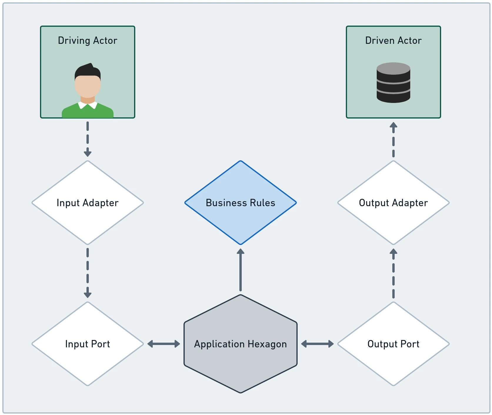

# Application Hexagon: Ports & Use Cases

The **Application Hexagon** serves as the orchestration center of Hexagonal Architecture. While the Domain Hexagon defines *what the business is*, the Application Hexagon defines *what the application can do*. It translates external actor intentions into domain actions by orchestrating domain entities, executing use cases, and bridging infrastructure boundaries via **Ports**.



---

## 1. Expressing Software Intent with Use Cases

A **Use Case** defines a discrete business workflow initiated by an actor. In a hexagonal Java application, each use case is declared as a clean, strongly typed Java interface that defines what operations the application provides:

```java
package dev.davivieira.topologyinventory.application.usecase;

import dev.davivieira.topologyinventory.domain.entity.Router;
import dev.davivieira.topologyinventory.domain.vo.IP;
import dev.davivieira.topologyinventory.domain.vo.Id;
import dev.davivieira.topologyinventory.domain.vo.Network;
import dev.davivieira.topologyinventory.domain.vo.RouterType;

public interface RouterManagementUseCase {
    Router createRouter(Id id, RouterType routerType, IP ip);
    Router retrieveRouter(Id id);
    Router addNetworkToRouter(Id routerId, Network network);
    Router removeNetworkFromRouter(Id routerId, Network network);
}
```

```java
package dev.davivieira.topologyinventory.application.usecase;

import dev.davivieira.topologyinventory.domain.entity.Switch;
import dev.davivieira.topologyinventory.domain.vo.IP;
import dev.davivieira.topologyinventory.domain.vo.Id;
import dev.davivieira.topologyinventory.domain.vo.SwitchType;

public interface SwitchManagementUseCase {
    Switch createSwitch(Id id, SwitchType switchType, IP ip);
    Switch retrieveSwitch(Id id);
}
```

### Architectural Advantages of Explicit Use Case Interfaces:
1. **Self-Documenting Architectural Surface:** A newcomer can glance at the `application.usecase` package and understand the full capabilities of the system without reading database queries or web endpoints.
2. **Decoupled Callers:** Driving adapters (REST, CLI, WebSocket) interact solely with the use case interface, ensuring that changes to the execution flow do not impact external communication protocols.

---

## 2. Input Ports: Implementing Use Cases

An **Input Port** is a concrete class inside the Application Hexagon that implements one or more Use Case interfaces. It acts as the orchestrator: it coordinates domain entities, verifies prerequisites, and triggers operations on Output Ports.

```java
package dev.davivieira.topologyinventory.application.ports.input;

import dev.davivieira.topologyinventory.application.ports.output.RouterManagementOutputPort;
import dev.davivieira.topologyinventory.application.usecase.RouterManagementUseCase;
import dev.davivieira.topologyinventory.domain.entity.Router;
import dev.davivieira.topologyinventory.domain.entity.factory.RouterFactory;
import dev.davivieira.topologyinventory.domain.vo.IP;
import dev.davivieira.topologyinventory.domain.vo.Id;
import dev.davivieira.topologyinventory.domain.vo.Network;
import dev.davivieira.topologyinventory.domain.vo.RouterType;

public class RouterManagementInputPort implements RouterManagementUseCase {

    private final RouterManagementOutputPort routerOutputPort;

    public RouterManagementInputPort(RouterManagementOutputPort routerOutputPort) {
        if (routerOutputPort == null) {
            throw new IllegalArgumentException("RouterManagementOutputPort cannot be null");
        }
        this.routerOutputPort = routerOutputPort;
    }

    @Override
    public Router createRouter(Id id, RouterType routerType, IP ip) {
        // 1. Delegate instantiation to a pure domain factory
        Router router = RouterFactory.createRouter(id, routerType, ip);
        
        // 2. Delegate persistence to the output port abstraction
        return routerOutputPort.persistRouter(router);
    }

    @Override
    public Router retrieveRouter(Id id) {
        return routerOutputPort.retrieveRouter(id);
    }

    @Override
    public Router addNetworkToRouter(Id routerId, Network network) {
        // 1. Fetch domain aggregate via output port
        Router router = routerOutputPort.retrieveRouter(routerId);
        
        // 2. Execute business invariant inside domain entity
        router.addNetworkToRouter(network);
        
        // 3. Persist modified aggregate back to output port
        return routerOutputPort.persistRouter(router);
    }

    @Override
    public Router removeNetworkFromRouter(Id routerId, Network network) {
        Router router = routerOutputPort.retrieveRouter(routerId);
        router.removeNetworkFromRouter(network);
        return routerOutputPort.persistRouter(router);
    }
}
```

---

## 3. Output Ports: Abstracting External Infrastructure

When a use case needs to fetch or store data, send an event, or invoke a remote service, it must **never** talk directly to concrete technology classes (e.g. `MySQLConnection` or `KafkaProducer`). Instead, the Application Hexagon defines an **Output Port** interface:

```java
package dev.davivieira.topologyinventory.application.ports.output;

import dev.davivieira.topologyinventory.domain.entity.Router;
import dev.davivieira.topologyinventory.domain.vo.Id;

public interface RouterManagementOutputPort {
    Router retrieveRouter(Id id);
    Router persistRouter(Router router);
}
```

```text
       [ APPLICATION HEXAGON ]                 [ FRAMEWORK HEXAGON ]
+------------------------------------+      +-------------------------+
|  RouterManagementInputPort         |      |                         |
|    |                               |      |                         |
|    | (invokes interface method)    |      |                         |
|    v                               |      |                         |
|  RouterManagementOutputPort <-------------|-- MySQLPanacheAdapter   |
|         (Java Interface)           |      |   (Implements Port)     |
+------------------------------------+      +-------------------------+
```

### Output Ports are Not Just Repositories:
While database persistence is the most frequent use case, Output Ports represent any required external interaction:
- **Event Notification Ports:** `EventPublisherOutputPort.publishRouterCreated(Router router)`
- **Remote RPC Ports:** `BgpRouteValidatorOutputPort.checkPrefixAvailability(IP ip, int cidr)`
- **Cache Ports:** `RouterCacheOutputPort.getOrCache(Id routerId)`

---

## 4. Boundary Protection: Domain Entities vs. DTOs

A frequent question in hexagonal application design is whether Use Cases and Ports should return Domain Entities or Data Transfer Objects (DTOs).

```text
Option 1: Domain Entities Cross Ports (Recommended for Pure POJO Domains)
[ Input Adapter ]  ===( Domain Entity )===>  [ Use Case Port ]

Option 2: DTOs Cross Ports (Recommended for Strict Isolation / Public APIs)
[ Input Adapter ]  ===( Request DTO )====>  [ Use Case Port ]
[ Use Case Port ]  <==( Response DTO )====  [ Input Adapter ]
```

| Criteria | Domain Entities Across Ports | Application DTOs Across Ports |
| :--- | :--- | :--- |
| **Boilerplate Code** | Minimal: no redundant DTO mapping classes. | Higher: requires request/response DTOs and mapping utilities. |
| **Encapsulation Safety** | Safe if domain entities return unmodifiable collections. | Absolute: callers receive immutable data records with no domain methods. |
| **Schema Evolution** | Changing a domain entity attribute impacts adapters. | Internal domain model can evolve independently of external contracts. |
| **Davi Vieira's Recommendation** | Excellent for small-to-midsize systems with rich, unpolluted POJO entities. | Recommended when multiple diverse teams consume the application port interfaces. |
