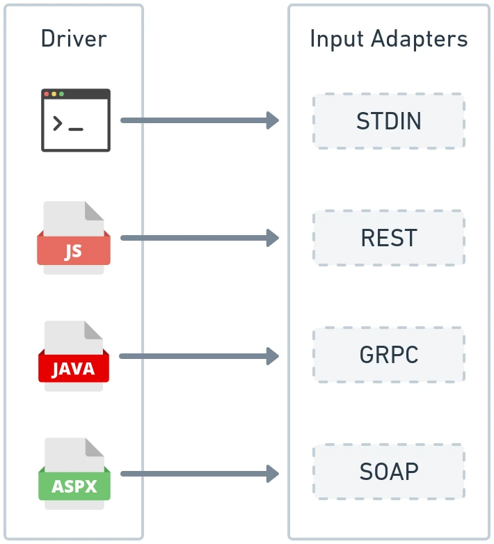
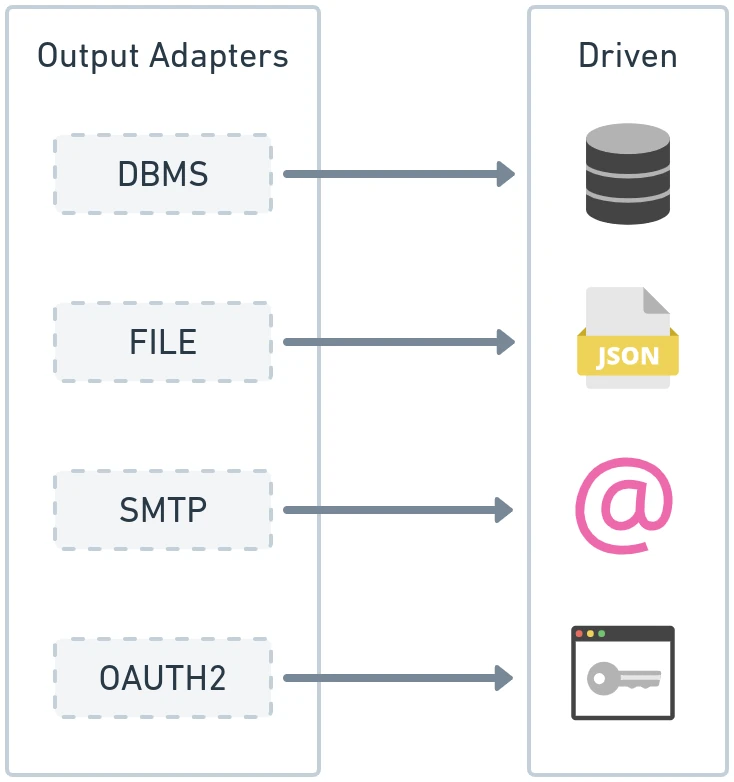
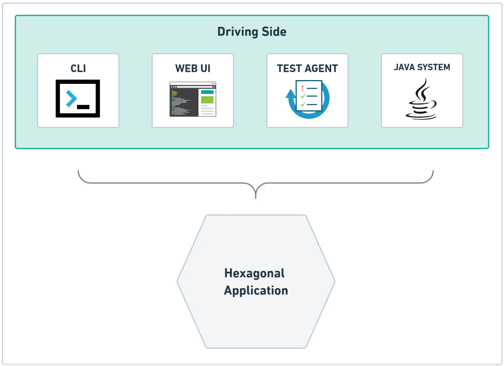

# Framework Hexagon: Driving & Driven Adapters

The **Framework Hexagon** represents the outermost perimeter of Hexagonal Architecture. It encloses all technological concerns: HTTP transport, serialization engines, database drivers, cloud messaging platforms, and CLI shells. The software components residing in this layer are called **Adapters**.

---

## 1. The Core Purpose of Adapters: Translation

An adapter's primary architectural responsibility is **bidirectional translation**:
1. It translates external data representations (HTTP JSON payloads, CLI arguments, Kafka records) into domain value objects and entities to invoke an **Input Port**.
2. It translates internal domain entities and exceptions back into external representations (HTTP response status codes, SQL queries, JSON DTOs).

```text
       DRIVING (INPUT) SIDE                       DRIVEN (OUTPUT) SIDE
+--------------------------------+       +------------------------------------+
|  Driving Adapter:              |       |  Driven Adapter:                   |
|  - REST JAX-RS Resource        |       |  - MySQL Panache Repository        |
|  - CLI Command Terminal        |       |  - Kafka Event Producer            |
|  - Integration Test Suite      |       |  - In-Memory Hash Map Repository   |
+--------------------------------+       +------------------------------------+
                |                                          ^
                v                                          |
  Invokes Input Port Interface             Implements Output Port Interface
                |                                          |
                +--------> [ APPLICATION CORE ] -----------+
```

---

## 2. Driving (Input) Adapters

A **Driving Adapter** initiates workflows on the system in response to external events.



For example, a REST API endpoint implemented in Quarkus using RESTEasy Reactive:

```java
package dev.davivieira.topologyinventory.framework.adapters.input.rest;

import dev.davivieira.topologyinventory.application.usecase.RouterManagementUseCase;
import dev.davivieira.topologyinventory.domain.entity.Router;
import dev.davivieira.topologyinventory.domain.vo.IP;
import dev.davivieira.topologyinventory.domain.vo.Id;
import dev.davivieira.topologyinventory.domain.vo.RouterType;
import dev.davivieira.topologyinventory.framework.adapters.input.rest.dto.CreateRouterRequest;
import jakarta.ws.rs.*;
import jakarta.ws.rs.core.MediaType;
import jakarta.ws.rs.core.Response;

@Path("/routers")
@Produces(MediaType.APPLICATION_JSON)
@Consumes(MediaType.APPLICATION_JSON)
public class RouterResource {

    private final RouterManagementUseCase routerUseCase;

    // Injected strictly via Use Case interface!
    public RouterResource(RouterManagementUseCase routerUseCase) {
        this.routerUseCase = routerUseCase;
    }

    @POST
    public Response createRouter(CreateRouterRequest request) {
        // 1. Convert external strings into strongly typed Domain Value Objects
        Id routerId = Id.of(request.id());
        RouterType routerType = RouterType.valueOf(request.type());
        IP routerIp = new IP(request.ip());

        // 2. Drive the application use case
        Router created = routerUseCase.createRouter(routerId, routerType, routerIp);

        // 3. Return 201 Created response
        return Response.status(Response.Status.CREATED).entity(created).build();
    }

    @GET
    @Path("/{id}")
    public Response getRouter(@PathParam("id") String id) {
        Router router = routerUseCase.retrieveRouter(Id.of(id));
        return Response.ok(router).build();
    }
}
```

Notice that:
- `RouterResource` holds no reference to any database class or concrete input port implementation.
- It parses input parameters and handles HTTP status codes (`201 Created`, `400 Bad Request`, `404 Not Found`).

---

## 3. Driven (Output) Adapters

A **Driven Adapter** implements an Output Port declared in the Application Hexagon. It translates domain requirements into concrete technical commands (e.g. SQL, NoSQL queries, or HTTP client calls).



Here is a driven adapter implementing database persistence with Quarkus Hibernate Panache:

```java
package dev.davivieira.topologyinventory.framework.adapters.output.database;

import dev.davivieira.topologyinventory.application.ports.output.RouterManagementOutputPort;
import dev.davivieira.topologyinventory.domain.entity.Router;
import dev.davivieira.topologyinventory.domain.vo.Id;
import dev.davivieira.topologyinventory.framework.adapters.output.database.data.RouterData;
import dev.davivieira.topologyinventory.framework.adapters.output.database.mappers.RouterMapper;
import dev.davivieira.topologyinventory.framework.adapters.output.database.repository.RouterPanacheRepository;
import jakarta.enterprise.context.ApplicationScoped;
import jakarta.inject.Inject;

@ApplicationScoped
public class RouterMySQLAdapter implements RouterManagementOutputPort {

    @Inject
    RouterPanacheRepository repository;

    @Override
    public Router retrieveRouter(Id id) {
        RouterData data = repository.findById(id.getUuid());
        if (data == null) {
            throw new IllegalArgumentException("Router not found with ID: " + id);
        }
        // Map database ORM entity to pure domain POJO
        return RouterMapper.toDomain(data);
    }

    @Override
    public Router persistRouter(Router router) {
        // Map pure domain POJO to database ORM entity
        RouterData data = RouterMapper.toData(router);
        repository.persistAndFlush(data);
        return router;
    }
}
```

### Isolating Database Schema via Mappers:
Notice that `RouterData` is an internal JPA class (`@Entity`, `@Table(name = "routers")`) residing purely inside the Framework Hexagon. The `RouterMapper` converts between `RouterData` and the pure POJO `Router`. If the database column name changes from `router_ip` to `ip_address`, **only the mapper and ORM entity change**—the Domain Hexagon is completely untouched!

---

## 4. End-to-End Request Lifecycle

When a client initiates an action, execution flows through the hexagons with strict separation of responsibilities:



```text
Sequence of an End-to-End Operation:
1. Client sends HTTP POST /routers {"id":"9b1d...","type":"CORE","ip":"10.0.0.1"}
2. RouterResource (Input Adapter) receives HTTP request.
3. RouterResource constructs Id, RouterType, and IP Value Objects.
4. RouterResource invokes routerUseCase.createRouter(...).
5. RouterManagementInputPort (Input Port) executes the usecase workflow.
6. RouterFactory creates the CoreRouter domain entity.
7. CoreRouter evaluates its business rules (NetworkAmountSpec, etc.).
8. RouterManagementInputPort invokes routerOutputPort.persistRouter(coreRouter).
9. RouterMySQLAdapter (Output Adapter) maps CoreRouter to RouterData.
10. RouterMySQLAdapter executes SQL INSERT via Panache/Hibernate.
11. Response flows back up to RouterResource, which emits HTTP 201 Created.
```
