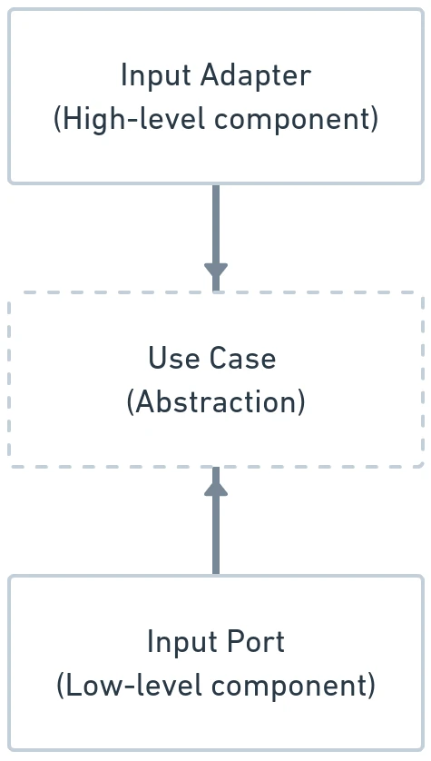

# Enforcing Boundaries with Java Modules (JPMS)

In standard Java projects, architectural layering is often enforced solely by package naming conventions (e.g. `com.example.domain`, `com.example.framework`). However, conventional Java packages cannot prevent accidental coupling: any `public` class can be imported by any other class on the classpath. Over time, developers inadvertently import framework classes into domain entities.

In *Designing Hexagonal Architecture with Java*, Davi Vieira demonstrates how the **Java Platform Module System (JPMS)**, introduced in Java 9, creates compile-time, physically unbreakable boundaries around each hexagon.



---

## 1. Why Package Conventions Fail

Consider a conventional single-jar Maven structure:
- A developer creating a domain entity needs to validate an IP address or UUID.
- They press autocomplete in their IDE and import `org.apache.commons.validator.routines.InetAddressValidator` or `jakarta.validation.constraints.NotNull`.
- Months later, another developer injects `EntityManager` or `HttpServletRequest` directly into an entity.

Because traditional classpath JARs have flat visibility, **package-private** access only protects intra-package elements, leaving `public` classes vulnerable to leakage across layers.

---

## 2. Multi-Module Hexagonal Structure

By dividing the application into separate Maven submodules, each with its own `module-info.java`, the compiler enforces the Hexagonal Architecture dependency rule:

```text
               [ DEPENDENCY FLOW IN JPMS ]
               
                  +-------------------+
                  |      domain       |  (requires NO frameworks)
                  +-------------------+
                            ^
                            | requires
                  +-------------------+
                  |    application    |  (requires domain)
                  +-------------------+
                            ^
                            | requires
                  +-------------------+
                  |     framework     |  (requires application, domain)
                  +-------------------+
                            ^
                            | requires
                  +-------------------+
                  |     bootstrap     |  (wires everything together)
                  +-------------------+
```

---

## 3. Configuring `module-info.java` per Hexagon

### 1. The Domain Module Descriptor
The domain module exports its entity, value object, and specification packages, but requires **only** `java.base`:

```java
// domain/src/main/java/module-info.java
module dev.davivieira.topologyinventory.domain {
    exports dev.davivieira.topologyinventory.domain.entity;
    exports dev.davivieira.topologyinventory.domain.entity.factory;
    exports dev.davivieira.topologyinventory.domain.vo;
    exports dev.davivieira.topologyinventory.domain.specification;
    exports dev.davivieira.topologyinventory.domain.service;
}
```

If a developer attempts to add a JPA annotation like `@Entity` or `@Table` inside the domain module, compilation immediately fails because Jakarta Persistence is not declared in `requires`.

### 2. The Application Module Descriptor
The application module requires `domain` and exports its use cases and ports:

```java
// application/src/main/java/module-info.java
module dev.davivieira.topologyinventory.application {
    requires dev.davivieira.topologyinventory.domain;

    exports dev.davivieira.topologyinventory.application.usecase;
    exports dev.davivieira.topologyinventory.application.ports.input;
    exports dev.davivieira.topologyinventory.application.ports.output;

    // Declares service provider interfaces consumed by the application
    uses dev.davivieira.topologyinventory.application.ports.output.RouterManagementOutputPort;
    uses dev.davivieira.topologyinventory.application.ports.output.SwitchManagementOutputPort;
}
```

### 3. The Framework Module Descriptor
The framework module requires both `domain` and `application`, plus technology-specific modules:

```java
// framework/src/main/java/module-info.java
module dev.davivieira.topologyinventory.framework {
    requires dev.davivieira.topologyinventory.domain;
    requires dev.davivieira.topologyinventory.application;
    requires jakarta.ws.rs;
    requires jakarta.enterprise.cdi.api;
    requires jakarta.inject;

    exports dev.davivieira.topologyinventory.framework.adapters.input.rest;
    exports dev.davivieira.topologyinventory.framework.adapters.output.database;

    // Provides concrete implementations of application output ports
    provides dev.davivieira.topologyinventory.application.ports.output.RouterManagementOutputPort
        with dev.davivieira.topologyinventory.framework.adapters.output.database.RouterMySQLAdapter;
}
```

---

## 4. Preventing Cyclic Dependencies

A critical safety feature of JPMS is that **cyclic dependencies are strictly prohibited at compile time**:
- If `Module A` requires `Module B`, `Module B` cannot require `Module A`.
- If an engineer attempts to call a framework adapter from the domain or application hexagon, the build fails instantly.

| Hexagon Module | Allowed Dependencies (`requires`) | Exported Capabilities (`exports`) |
| :--- | :--- | :--- |
| **Domain** | `java.base` only | Domain Entities, VOs, Specs, Domain Services |
| **Application** | `domain` | Use Cases, Input Ports, Output Ports |
| **Framework** | `domain`, `application`, Framework SDKs | REST Adapters, DB Adapters, CLI Adapters |
| **Bootstrap** | All of the above | Main Entrypoint, DI Configuration |
