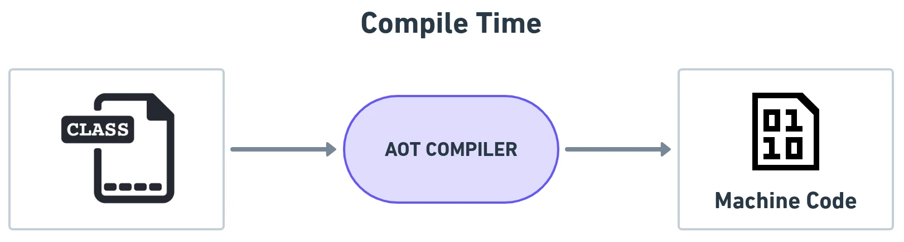

# Quarkus CDI & The Bootstrap Module

When deploying hexagonal applications to the cloud, traditional enterprise Java frameworks often introduce significant overhead: slow startup times (10–30 seconds) and high baseline memory footprints (300MB–1GB RSS). **Quarkus** ("Supersonic Subatomic Java") solves this by moving dependency injection and metadata processing from runtime to build time.

In *Designing Hexagonal Architecture with Java*, Davi Vieira introduces a fourth architectural module—the **Bootstrap Hexagon**—and demonstrates how to wire ports and adapters using Quarkus Contexts and Dependency Injection (CDI / Arc).



---

## 1. The Fourth Hexagon: Bootstrap Module

To keep the Domain, Application, and Framework hexagons clean and unopinionated, a dedicated **Bootstrap** module acts as the aggregation root of the system.

```text
+--------------------------------------------------------------+
|                       BOOTSTRAP MODULE                       |
|   - Configures Quarkus runtime (application.properties)      |
|   - Holds main entry point / Quarkus application root        |
|   - Aggregates Maven dependencies:                           |
|       * domain                                               |
|       * application                                          |
|       * framework                                            |
|       * io.quarkus:quarkus-resteasy-reactive                 |
|       * io.quarkus:quarkus-hibernate-reactive-panache        |
+--------------------------------------------------------------+
```

### Maven Dependency Tree of the Hexagonal System:
```text
topology-inventory (root pom)
├── domain       (pure POJOs, zero external deps)
├── application  (depends on domain)
├── framework    (depends on domain, application, and framework APIs)
└── bootstrap    (depends on domain, application, framework, and Quarkus engine)
```

---

## 2. Managing Ports with Quarkus Arc CDI

Quarkus provides **Arc**, a build-time dependency injection container compatible with Jakarta CDI 4.0. Arc eliminates heavy runtime reflection by generating bytecode classes at build time.

### 1. Declaring Output Adapters as CDI Beans:
The MySQL adapter in the framework hexagon is annotated with `@ApplicationScoped`:

```java
package dev.davivieira.topologyinventory.framework.adapters.output.database;

import dev.davivieira.topologyinventory.application.ports.output.RouterManagementOutputPort;
import jakarta.enterprise.context.ApplicationScoped;

@ApplicationScoped
public class RouterMySQLAdapter implements RouterManagementOutputPort {
    // Adapter implementation
}
```

### 2. Producing Input Ports:
Since `RouterManagementInputPort` lives in the `application` hexagon, we avoid annotating it with framework-specific annotations like `@ApplicationScoped`. Instead, we produce it in a CDI configuration class inside the bootstrap or framework layer:

```java
package dev.davivieira.topologyinventory.bootstrap.config;

import dev.davivieira.topologyinventory.application.ports.input.RouterManagementInputPort;
import dev.davivieira.topologyinventory.application.ports.output.RouterManagementOutputPort;
import dev.davivieira.topologyinventory.application.usecase.RouterManagementUseCase;
import jakarta.enterprise.context.ApplicationScoped;
import jakarta.enterprise.inject.Produces;

@ApplicationScoped
public class ApplicationBeansProducer {

    @Produces
    @ApplicationScoped
    public RouterManagementUseCase routerManagementUseCase(RouterManagementOutputPort outputPort) {
        return new RouterManagementInputPort(outputPort);
    }
}
```

This producer pattern ensures the `application` hexagon remains 100% agnostic of Jakarta CDI annotations while allowing Quarkus to inject `RouterManagementUseCase` seamlessly into REST resources.

---

## 3. BDD Testing with Cucumber and Quarkus

One of the greatest payoffs of clean hexagonal boundaries is testing velocity. Business use cases can be verified using Behavior-Driven Development (BDD) via Cucumber without spinning up web servers or live databases.

```gherkin
Feature: Router Management
  Scenario: Add a new valid network to a core router
    Given a core router exists with ID "9b1deb4d-3b7d-4bad-9bdd-2b0d7b3dcb6d"
    When the administrator adds network "10.0.0.0/24" to the router
    Then the router should contain 1 active network
    And the router state is successfully persisted
```

Because use cases are exposed via clean Java interfaces (`RouterManagementUseCase`), Cucumber test step definitions simply invoke the use case interface backed by an in-memory test double:

```java
public class RouterManagementSteps {
    private RouterManagementUseCase useCase = new RouterManagementInputPort(new InMemoryRouterAdapter());
    // Step definitions execute in milliseconds!
}
```
