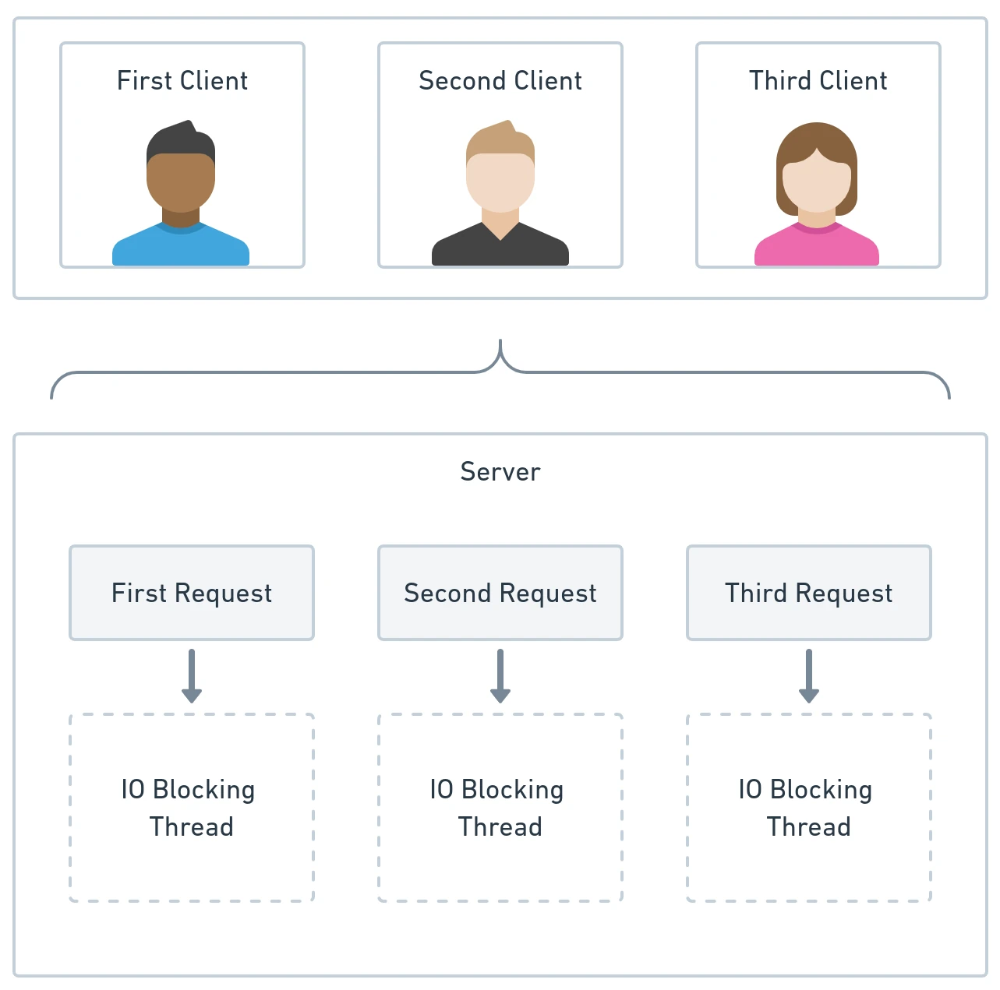

# Reactive Input & Output with RESTEasy & Hibernate

High-throughput cloud-native microservices often spend significant time waiting on I/O operations (network hops, database queries, downstream service calls). Traditional imperative thread-per-request models can exhaust thread pools under load. 

By leveraging **RESTEasy Reactive** for driving adapters and **Hibernate Reactive with Panache** for driven adapters, Quarkus enables end-to-end non-blocking execution while maintaining clean hexagonal isolation.



---

## 1. Imperative vs. Reactive Execution Models

```text
Imperative Model (Thread-Per-Request):
Request 1  ---> [ OS Thread 1 ] ---> [ Blocks on DB I/O ] ---> Response 1
Request 2  ---> [ OS Thread 2 ] ---> [ Blocks on DB I/O ] ---> Response 2
(Limited by maximum thread pool size, high memory overhead per thread)

Reactive Non-Blocking Model (Event-Loop Driven):
Request 1  -\
Request 2  ---> [ Event Loop Thread ] ---> [ Non-Blocking Async I/O ] ---> Responses
Request 3  -/
(Single thread handles thousands of concurrent in-flight I/O operations)
```

---

## 2. Reactive Driving Adapters with RESTEasy Reactive

RESTEasy Reactive integrates directly with the underlying Netty event loop. Using SmallRye Mutiny reactive primitives (`Uni<T>` for zero or one item, `Multi<T>` for streams), endpoints never block worker threads.

```java
package dev.davivieira.topologyinventory.framework.adapters.input.rest;

import dev.davivieira.topologyinventory.application.usecase.RouterManagementUseCase;
import dev.davivieira.topologyinventory.domain.entity.Router;
import dev.davivieira.topologyinventory.domain.vo.IP;
import dev.davivieira.topologyinventory.domain.vo.Id;
import dev.davivieira.topologyinventory.domain.vo.RouterType;
import dev.davivieira.topologyinventory.framework.adapters.input.rest.dto.CreateRouterRequest;
import io.smallrye.mutiny.Uni;
import jakarta.ws.rs.*;
import jakarta.ws.rs.core.MediaType;
import jakarta.ws.rs.core.Response;

@Path("/v2/routers")
@Produces(MediaType.APPLICATION_JSON)
@Consumes(MediaType.APPLICATION_JSON)
public class RouterReactiveResource {

    private final RouterManagementUseCase routerUseCase;

    public RouterReactiveResource(RouterManagementUseCase routerUseCase) {
        this.routerUseCase = routerUseCase;
    }

    @POST
    public Uni<Response> createRouter(CreateRouterRequest request) {
        return Uni.createFrom().item(() -> {
            Router router = routerUseCase.createRouter(
                Id.of(request.id()),
                RouterType.valueOf(request.type()),
                new IP(request.ip())
            );
            return Response.status(Response.Status.CREATED).entity(router).build();
        });
    }
}
```

---

## 3. Reactive Driven Adapters with Hibernate Reactive & Panache

Traditional JDBC drivers are inherently blocking. Hibernate Reactive replaces JDBC with reactive, non-blocking database drivers (such as Vert.x Reactive MySQL / PostgreSQL clients).

With **Panache Reactive**, repositories manage database records asynchronously using Mutiny:

```java
package dev.davivieira.topologyinventory.framework.adapters.output.database;

import dev.davivieira.topologyinventory.framework.adapters.output.database.data.RouterData;
import io.quarkus.hibernate.reactive.panache.PanacheRepositoryBase;
import io.smallrye.mutiny.Uni;
import jakarta.enterprise.context.ApplicationScoped;
import java.util.UUID;

@ApplicationScoped
public class RouterPanacheReactiveRepository implements PanacheRepositoryBase<RouterData, UUID> {
    public Uni<RouterData> findByIpAddress(String ip) {
        return find("ip", ip).firstResult();
    }
}
```

### Implementing the Reactive Output Adapter:

```java
package dev.davivieira.topologyinventory.framework.adapters.output.database;

import dev.davivieira.topologyinventory.application.ports.output.RouterReactiveOutputPort;
import dev.davivieira.topologyinventory.domain.entity.Router;
import dev.davivieira.topologyinventory.domain.vo.Id;
import dev.davivieira.topologyinventory.framework.adapters.output.database.mappers.RouterMapper;
import io.smallrye.mutiny.Uni;
import jakarta.enterprise.context.ApplicationScoped;
import jakarta.inject.Inject;

@ApplicationScoped
public class RouterReactiveMySQLAdapter implements RouterReactiveOutputPort {

    @Inject
    RouterPanacheReactiveRepository repository;

    @Override
    public Uni<Router> retrieveRouter(Id id) {
        return repository.findById(id.getUuid())
            .onItem().ifNotNull().transform(RouterMapper::toDomain)
            .onItem().ifNull().failWith(() -> new IllegalArgumentException("Router not found"));
    }

    @Override
    public Uni<Router> persistRouter(Router router) {
        var routerData = RouterMapper.toData(router);
        return repository.persistAndFlush(routerData)
            .replaceWith(router);
    }
}
```

---

## 4. Preserving Domain Purity in Reactive Architectures

A critical architectural discipline when introducing reactive libraries is **keeping reactive types out of the domain hexagon**:
- **Domain Hexagon:** Remains purely functional and synchronous. Methods like `router.addNetworkToRouter(network)` or `networkSpec.isSatisfiedBy(router)` should never accept or return `Uni<T>`, `Flux<T>`, or `Mono<T>`.
- **Framework & Application Boundary:** The reactive pipeline (`Uni.chain`, `transform`, `onFailure`) coordinates async I/O in the adapters and ports, passing concrete domain objects into the domain methods.
