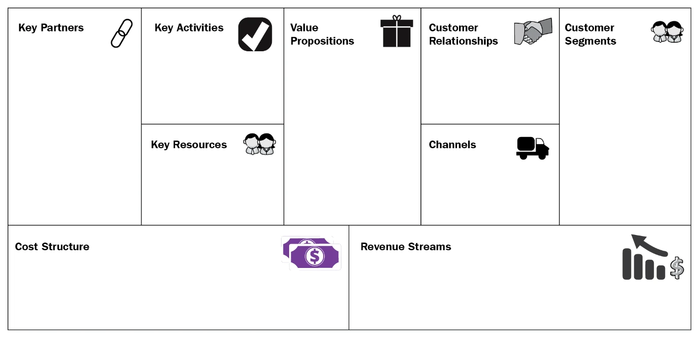

# Containerization, GraalVM Native & Kubernetes

Building maintainable code is only half the battle; deploying, observing, and autoscaling that code in production cloud environments is equally critical. In the final section of *Designing Hexagonal Architecture with Java*, Davi Vieira demonstrates how to package a multi-module hexagonal Quarkus application into container images, compile to GraalVM native binaries, and deploy onto Kubernetes.



---

## 1. Multi-Stage Docker Packaging

A multi-module Maven project requires careful build orchestration to generate lightweight container images without bloating the image with Maven build caches, plugins, or source files.

### Multi-Stage Dockerfile for Hexagonal Quarkus Applications:

```dockerfile
# Stage 1: Build the multi-module Maven project
FROM maven:3.9-eclipse-temurin-17 AS builder
WORKDIR /project
COPY pom.xml .
COPY domain/pom.xml domain/
COPY application/pom.xml application/
COPY framework/pom.xml framework/
COPY bootstrap/pom.xml bootstrap/
# Cache Maven dependencies
RUN mvn dependency:go-offline -B

COPY . .
RUN mvn clean package -DskipTests -Dquarkus.package.type=fast-jar

# Stage 2: Minimal runtime image
FROM eclipse-temurin:17-jre-alpine
WORKDIR /deployments
COPY --from=builder /project/bootstrap/target/quarkus-app/lib/ /deployments/lib/
COPY --from=builder /project/bootstrap/target/quarkus-app/*.jar /deployments/
COPY --from=builder /project/bootstrap/target/quarkus-app/app/ /deployments/app/
COPY --from=builder /project/bootstrap/target/quarkus-app/quarkus/ /deployments/quarkus/

EXPOSE 8080
USER 1001
ENTRYPOINT ["java", "-jar", "/deployments/quarkus-run.jar"]
```

---

## 2. JVM vs. GraalVM Native Executables

Quarkus allows compiling Java bytecode into an OS-native executable binary using GraalVM Ahead-Of-Time (AOT) compilation.

| Metric | JVM Mode (HotSpot) | GraalVM Native Binary |
| :--- | :--- | :--- |
| **Startup Time** | 1.5 – 3.0 seconds | **15 – 45 milliseconds** |
| **First Request Latency** | Minor JIT warmup delay | Instantaneous peak performance |
| **Base RSS Memory** | 150 – 350 MB | **25 – 45 MB** |
| **Build Time** | 30 – 60 seconds | 3 – 8 minutes |
| **Best Used For** | Long-running microservices with heavy sustained throughput | Serverless functions (AWS Lambda), rapid autoscaling pods |

Because the hexagonal architecture strictly decouples domain logic and avoids uncontrolled reflection in domain models, compiling to native with `mvn package -Pnative` works smoothly with minimal reflection configuration (`reflection-config.json`).

---

## 3. Kubernetes Manifests: Deployment & Service

Deploying our hexagonal service onto Kubernetes involves configuring the Deployment object with health checks and a ClusterIP Service.

### Deployment Configuration (`topology-inventory-deployment.yaml`):

```yaml
apiVersion: apps/v1
kind: Deployment
metadata:
  name: topology-inventory
  labels:
    app: topology-inventory
spec:
  replicas: 3
  selector:
    matchLabels:
      app: topology-inventory
  template:
    metadata:
      labels:
        app: topology-inventory
    spec:
      containers:
        - name: topology-inventory
          image: myregistry.io/topology-inventory:1.0.0
          imagePullPolicy: IfNotPresent
          ports:
            - containerPort: 8080
          env:
            - name: QUARKUS_DATASOURCE_REACTIVE_URL
              value: "mysql://mysql-service:3306/inventory"
            - name: QUARKUS_DATASOURCE_USERNAME
              valueFrom:
                secretKeyRef:
                  name: db-credentials
                  key: username
          resources:
            requests:
              memory: "64Mi"
              cpu: "100m"
            limits:
              memory: "256Mi"
              cpu: "500m"
          livenessProbe:
            httpGet:
              path: /q/health/live
              port: 8080
            initialDelaySeconds: 5
            periodSeconds: 10
          readinessProbe:
            httpGet:
              path: /q/health/ready
              port: 8080
            initialDelaySeconds: 2
            periodSeconds: 5
```

---

## 4. Health Probes & Observability

Quarkus exposes SmallRye Health endpoints automatically at `/q/health`:
- `/q/health/live`: Verifies the pod's container process is alive and responsive.
- `/q/health/ready`: Confirms that driven adapters have established healthy connections to underlying data sources (e.g. MySQL pool is active).

This completes the journey from clean object-oriented architecture in pure Java POJOs to resilient, observable, cloud-native deployments on Kubernetes.
