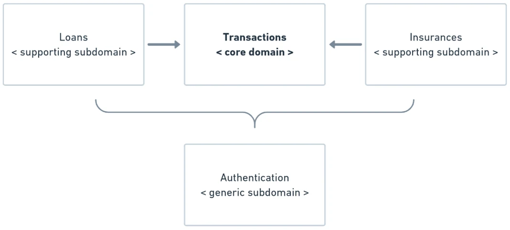

# DDD Synergy, Multiple Adapters & Anti-Patterns

Applying Hexagonal Architecture in production requires combining its structural principles with **Domain-Driven Design (DDD)** and avoiding subtle architectural smells that erode the boundaries over time.



---

## 1. DDD Synergy with Hexagonal Architecture

Hexagonal Architecture provides the physical boundary, while Domain-Driven Design supplies the conceptual modeling tools:

```text
       [ STRATEGIC & TACTICAL DDD IN HEXAGONS ]

1. Ubiquitous Language:
   - Identical terminology used by domain experts, code, and use cases.
   - Example: CoreRouter, EdgeRouter, CIDR, Ingress, Egress.

2. Bounded Context:
   - Each hexagonal application forms one Bounded Context.
   - Example: "Topology Inventory Context" communicates with "Billing Context"
     exclusively through Output Ports and Adapters, never by sharing database tables.

3. Tactical Building Blocks:
   - Entities, Value Objects, Aggregates, Domain Events -> DOMAIN HEXAGON
   - Application Services / Use Cases                   -> APPLICATION HEXAGON
   - Repositories, Message Producers, Web Controllers  -> FRAMEWORK HEXAGON
```

---

## 2. Managing Multiple Adapters on a Single Port

One of the greatest operational strengths of hexagonal systems is the ability to attach multiple adapters to the same port without modifying business logic.

```text
               +--------------------------------------+
               |    RouterManagementUseCase (Port)    |
               +--------------------------------------+
                     ^            ^             ^
                     |            |             |
        +------------+            |             +------------+
        |                         |                          |
+-------------------+   +--------------------+   +---------------------+
| REST API Adapter  |   | CLI Terminal App   |   | Kafka Event Consumer|
| (RESTEasy JAX-RS) |   | (Picocli Terminal) |   | (SmallRye Reactive) |
+-------------------+   +--------------------+   +---------------------+
```

- When an HTTP client submits a POST request, `RouterResource` calls `createRouter(...)`.
- When an engineer runs `inventory-cli create-router --id 123 --ip 10.0.0.1`, the CLI adapter calls the exact same `createRouter(...)`.
- When an automated network discovery tool sends an event over Kafka, a Kafka consumer adapter parses the message and calls the exact same `createRouter(...)`.

Because validation and domain invariants live inside the Domain and Application hexagons, every adapter automatically adheres to identical business rules.

---

## 3. Four Hexagonal Anti-Patterns to Avoid

Even well-intentioned teams can inadvertently violate hexagonal integrity. Watch out for these four common anti-patterns:

### 1. The Anemic Domain Anti-Pattern
- **Symptom:** Domain entities are reduced to dumb data holders (getters and setters), while all validation and logic is placed inside the Input Port.
- **Remedy:** Keep entities rich. Invariants such as `router.addNetworkToRouter(...)` must be validated inside the entity or via Specification objects.

### 2. The Framework Contamination Anti-Pattern
- **Symptom:** Annotating domain entities with `@Entity`, `@Table`, `@JsonProperty`, or importing Spring/Jakarta annotations inside the domain module.
- **Remedy:** Use JPMS module isolation (`requires java.base;` only). Create distinct ORM entities (`RouterData`) in the framework hexagon and map them to domain entities using mappers.

### 3. Leaky Output Port Interfaces
- **Symptom:** Defining methods on output ports that expose technological concepts (e.g. `List<Router> findBySqlQuery(String sql)` or `Page<Router> find(PageRequest page)`).
- **Remedy:** Output ports must speak the ubiquitous language of the domain. Use domain primitives and domain value objects for query parameters.

### 4. The Adapter Bypass Anti-Pattern
- **Symptom:** A driving adapter (such as a REST controller) directly injects and queries a database repository (output adapter) to quickly render a response, bypassing the application use case and domain rules.
- **Remedy:** All interactions must pass through the Application Hexagon via Use Cases. Never allow direct adapter-to-adapter calls.

---

## 4. Summary Checklist for Hexagonal Architects

| Checkpoint | Pass Criteria |
| :--- | :--- |
| **Domain Purity** | Zero framework imports in the domain module. |
| **Immutability** | Value objects are immutable and validate invariants in constructor. |
| **Decoupled Ports** | Input ports implement Use Case interfaces; output ports are interfaces. |
| **Adapter Isolation** | Technical concerns (JPA, HTTP, Kafka) reside exclusively in framework adapters. |
| **Build-Time Safety** | JPMS or Gradle module boundaries enforce one-way dependency rules. |
