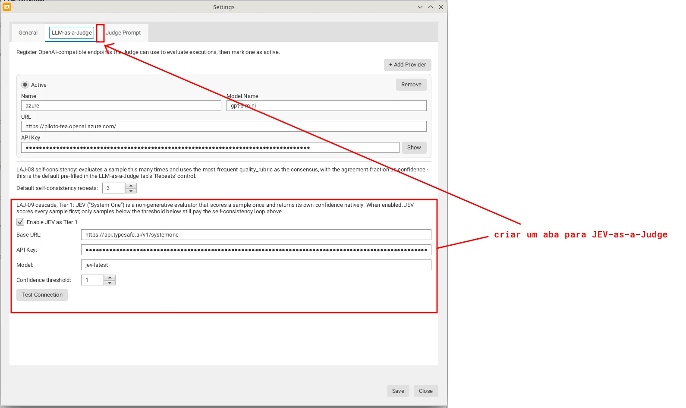

# Agent Visualizer Evaluation Engine & Data Model

Automating the evaluation of autonomous cognitive agents requires transitioning from ad-hoc manual inspections to robust, reproducible, and verifiable evaluation pipelines. In production and research testbeds—such as evaluating mobile agents built on cognitive architectures like CoALA (Cognitive Architectures for Language Agents)—scoring every execution manually does not scale.

The **Agent Visualizer** (`agent-visualizer`) evaluation engine addresses this bottleneck by implementing a structured, modular evaluation pipeline supporting both generative **LLM-as-a-Judge** and decision-only **JEV-as-a-Judge** workflows.

---

## 1. Domain Context: Evaluating Cognitive Agent Runs

In mobile agent testbeds (e.g., evaluating an agent managing Android notifications, health data, and daily planning across multiple sessions), executions are grouped into standardized experimental tasks:

- `T1_daily_summary`: Summarizing local daily health and calendar metrics.
- `T2_within_session_wm`: Multi-turn conversational continuity in Working Memory.
- `T3_get_time`: Deterministic system tool invocation (`get_time`).
- `T4_open_health_tip`: Open-ended health coaching and guidance.
- `T5_cross_session_ltm`: Long-Term Memory recall across completely separate chat sessions.

Evaluating these tasks requires checking whether the agent adhered to strict behavioral criteria (e.g., retrieving the user's weekly hydration goal in `T5` after a chat reset) rather than merely generating fluent text.

---

## 2. Core Domain Data Model

The evaluation engine is built around deterministic Java data records that maintain an immutable audit trail of how decisions were reached.

```text
+-------------------------------------------------------------+
|                        BlindSample                          |
|  - sampleId: String ("run_2026-10-30_t5_01")                |
|  - prompt: String ("Qual foi a meta que defini?")           |
|  - response: String ("Sua meta era beber mais água...")     |
|  - taskId: String ("T5_cross_session_ltm")                  |
+-------------------------------------------------------------+
                               |
                               v
+-------------------------------------------------------------+
|                        JudgeResult                          |
|  - score: int (0 to 10)                                     |
|  - successMin: boolean (true / false)                       |
|  - qualityRubric: int (0=Insuf., 1=Gen., 2=Min., 3=Ideal)   |
|  - qualitativeNotes: String                                 |
|  - justification: String                                    |
|  - modelName: String                                        |
+-------------------------------------------------------------+
                               |
                               v
+-------------------------------------------------------------+
|                   JudgeConfidenceResult                     |
|  - sampleId: String                                         |
|  - consensus: JudgeResult                                   |
|  - confidence: double (0.0 to 1.0)                          |
|  - runs: List<JudgeResult> (1 for JEV, N for LLM)           |
|  - tier: Tier (JEV | JEV_THEN_LLM... | LLM_SELF_CONSISTENCY)|
|  - jevAttempt: JevScore (optional native score/confidence)  |
+-------------------------------------------------------------+
```

### The 0–3 Canonical Quality Rubric

To make qualitative judgments defendable under inter-rater reliability analysis (such as Cohen's Kappa $\kappa$), evaluations avoid unstructured 1–10 scores in favor of a 4-level ordinal rubric:

| Level | Rubric Label | Meaning |
| :---: | :--- | :--- |
| **0** | **Insuficiente** | Total failure, hallucination, refusal, or wrong memory recall. |
| **1** | **Em desenvolvimento / genérico** | Vague or generic response without specific task recall. |
| **2** | **Atende ao mínimo operacional** | Satisfies operational minimum (`success_min = true`). |
| **3** | **Ideal, contextualizado e completo** | Accurate, fully framed, and contextualized. |

---

## 3. Evaluation Engines: Single-Shot vs. Error-Scan

The platform provides two distinct evaluation services sharing common HTTP plumbing:

### 1. Task-Rubric Evaluation (`JudgeEvaluationService`)
The primary engine evaluates candidate responses against task-specific rubrics. It injects the user prompt, agent response, and optional reference timestamps into prompt templates managed by `JudgePromptConfig`:

```java
private static String buildPrompt(BlindSample sample, JudgeTask task) {
    return JudgePromptConfig.getTemplate(task)
            .replace(JudgePromptConfig.USER_PROMPT_PLACEHOLDER, 
                     sample.prompt())
            .replace(JudgePromptConfig.AGENT_RESPONSE_PLACEHOLDER, 
                     sample.response())
            .replace(JudgePromptConfig.REFERENCE_TIMESTAMP_PLACEHOLDER,
                     sample.referenceTimestamp() != null 
                         ? sample.referenceTimestamp() 
                         : "desconhecido");
}
```

The model is strictly constrained to return a single JSON object conforming to the contract:

```json
{
  "score": 8,
  "success_min": true,
  "quality_rubric": 2,
  "qualitative_notes": "Recuperou meta de hidratação sem detalhes.",
  "justification": "O agente declarou a meta corretamente."
}
```

### 2. Forensic Error-Scanning (`JudgeErrorScanService`)
In addition to grading answers, the engine scans the full Markdown execution report (tool calls, intermediate CoALA thought steps, and Android Logcat traces) looking for runtime exceptions, timeout errors, or hidden agent failures.

---

## 4. Multi-Provider Architecture & Configuration

Both the generative LLM judge and the decision-only JEV evaluator support multi-provider configurations with live switching in the UI:



- **`ModelProvider`**: Configures OpenAI-compatible chat-completions endpoints (e.g., local Ollama, Claude, or GPT-4o) with URL, API key, model name, and temperature ($0.0$).
- **`JevProvider`**: Configures dedicated JEV ("System One") endpoints, storing endpoint URL, API key, model version (`jev-latest`), and an independent **Confidence Threshold** ($\tau_{\text{jev}}$).

---

## 5. Architectural Takeaways

1. **Separation of Concerns:** `BlindSample` ensures judges score prompt/response pairs blindly without knowing agent model conditions (A, B, C, D, or E).
2. **Deterministic Schemas:** The JSON contract isolates downstream analytics from unstructured LLM hallucinations.
3. **Pluggable Providers:** Decoupling HTTP transport (`JudgeModelClient`, `JevClient`) from UI controllers allows batch evaluation via either desktop UI or automated command-line CI scripts.
