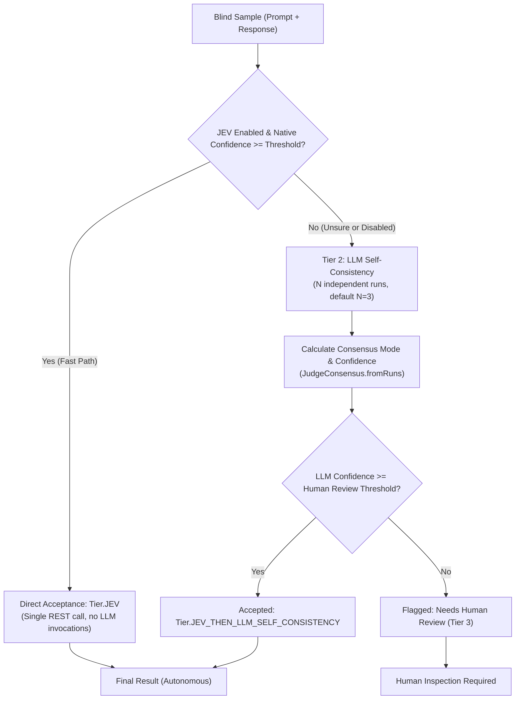
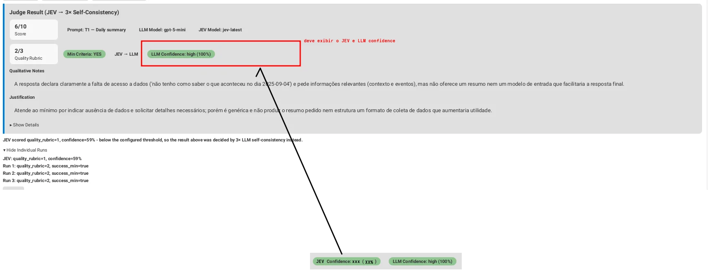
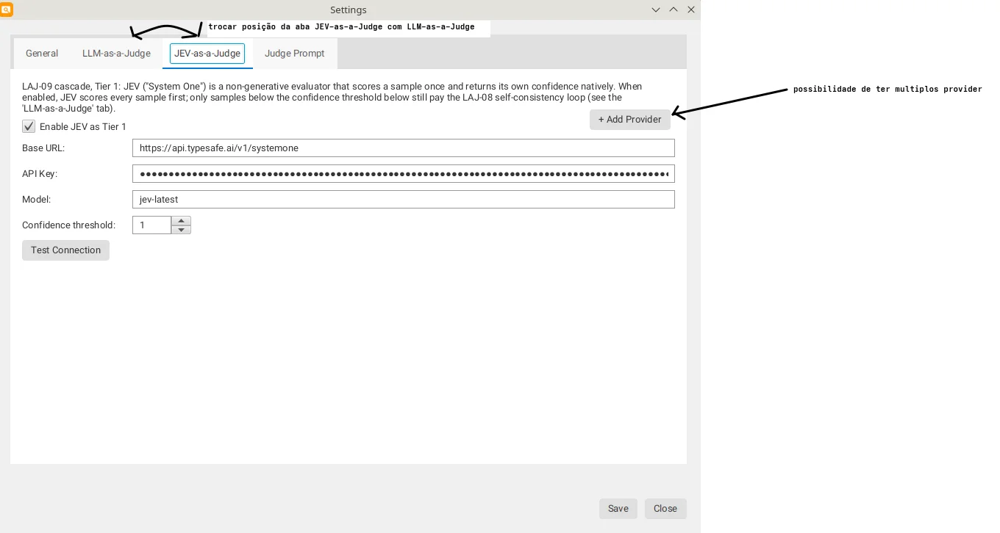

# The 3-Tier Cascade & Consensus Engine

While automated evaluation using a single generative LLM call provides a baseline score, it suffers from two major limitations: it provides no measure of confidence, and invoking frontier generative LLMs for every routine sample is computationally expensive.

The `agent-visualizer` architecture solves this through an adaptive **3-Tier Cascade Engine** (`LAJ-09`): routing easy cases through a fast decision-only model, escalating uncertain cases to generative self-consistency, and reserving manual human review strictly for edge cases.

---

## 1. The 3-Tier Architecture Overview

The cascade operates as a strict 2-step decision chain:





---

## 2. Tier 1: JEV ("System One") Fast Path

The first tier leverages **JEV** (TypeSafe AI's "System One" decision model). Unlike generative LLMs that produce explanatory prose, JEV is a decision-only endpoint invoked via `POST /v1/systemone`.

### Wire Request Format
```json
{
  "model": "jev-latest",
  "state": "Prompt do usuário:\n...\n\nResposta do agente:\n...",
  "questions": {
    "quality_rubric": {
      "type": "score",
      "instructions": "Avalie se a resposta recupera a meta...",
      "criteria": [
        "Insuficiente",
        "Em desenvolvimento/genérico",
        "Atende ao mínimo operacional",
        "Ideal, contextualizado e completo"
      ]
    }
  }
}
```

### JEV Response Handling
JEV returns a structured score index ($0$ to $3$) alongside a native calibrated confidence value ($\in [0.0, 1.0]$):

```java
if (jevEnabled) {
    jevScore = jevClient.score(
        jevProvider.baseUrl(), jevProvider.apiKey(), 
        jevProvider.modelName(), judgeTask, sample
    );
    
    if (jevScore.confidence() >= jevProvider.confidenceThreshold()) {
        // High confidence: short-circuit and bypass LLM loop entirely!
        results.add(fromJevScore(sample, judgeTask, jevScore));
        continue;
    }
}
```

If JEV's confidence meets or exceeds the provider's configured adoption threshold (e.g., $\tau_{\text{jev}} = 0.80$), the result is accepted immediately under `Tier.JEV`. No generative tokens are consumed.

---

## 3. Tier 2: LLM Self-Consistency & Mode Consensus

If JEV is disabled, or if its confidence falls below the adoption threshold, the evaluation automatically escalates to **Tier 2: Generative Self-Consistency** (`LAJ-08`).



The sample is submitted $N$ times (default $N = 3$, with temperature $T > 0$ or across stochastic calls) to the active `ModelProvider`.

### Consensus Computation (`JudgeConsensus`)
The final score is derived using the statistical **mode** of the `quality_rubric` across all $N$ runs:

$$\text{Confidence} = \frac{\text{Frequency of Mode}}{N}$$

For $N = 3$:
- $3/3$ agreement $\implies \text{Confidence} = 1.00$ (`high`)
- $2/3$ agreement $\implies \text{Confidence} = 0.67$ (`med`)
- $1/3$ (three-way tie) $\implies \text{Confidence} = 0.33$ (`low`)

### Deterministic Tie-Breaking
When an even number of runs results in a tie between equally frequent rubrics, `JudgeConsensus.pickTieBreakValue` applies a deterministic two-step rule:
1. Select the rubric closest to the **median** of all runs.
2. If distances to the median are identical, choose the **lower value** (conservative scoring principle).

```java
private static int pickTieBreakValue(List<Integer> tiedModes, 
                                     List<JudgeResult> runs) {
    List<Integer> sorted = new ArrayList<>(
        runs.stream().map(JudgeResult::qualityRubric).toList()
    );
    sorted.sort(Comparator.naturalOrder());
    double median = median(sorted);

    return tiedModes.stream()
            .min(Comparator.<Integer>comparingDouble(v -> Math.abs(v - median))
                    .thenComparingInt(v -> v))
            .orElseThrow();
}
```

---

## 4. Tier 3: Selective Human Escalation

The transition to human review is governed by an independent threshold: `JudgePromptConfig.getHumanReviewThreshold()` (default $\tau_{\text{human}} = 1.00$).

```java
public boolean needsHumanReview(double threshold) {
    return tier != Tier.JEV && confidence < threshold;
}
```

### The Strict 2-Step Invariance Rule
Notice the condition `tier != Tier.JEV`:
- **`Tier.JEV` is NEVER flagged for human review:** Because a sample resolved by JEV has already satisfied the provider's adoption threshold ($\text{confidence} \ge \tau_{\text{jev}}$), subjecting it to a secondary human review threshold would be architecturally contradictory.
- **Only LLM Decisions are Flagged:** When the LLM decides (`Tier.LLM_SELF_CONSISTENCY` or `Tier.JEV_THEN_LLM_SELF_CONSISTENCY`), if consensus agreement is lower than $\tau_{\text{human}}$ (e.g., $2/3 = 0.67 < 1.00$), the system tags the item with a visible **"Needs Human Review"** badge.

---

## 5. Economic & Architectural Impact

| Metric | Single Generative Call | Pure Self-Consistency (3x) | 3-Tier Cascade |
| :--- | :---: | :---: | :---: |
| **LLM Calls (Confident JEV)** | 1 | 3 | **0** (REST only) |
| **LLM Calls (Unsure JEV)** | 1 | 3 | 3 |
| **Confidence Metric** | None (Raw output) | Agreement fraction | Dual (Calibrated + Agreement) |
| **Cost Reduction** | Baseline ($1\times$) | $3\times$ higher | **$40\%\text{--}70\%$ savings** |
| **Human Workload** | Review 100% or trust blindly | Review ~35% | Review < 15% |
