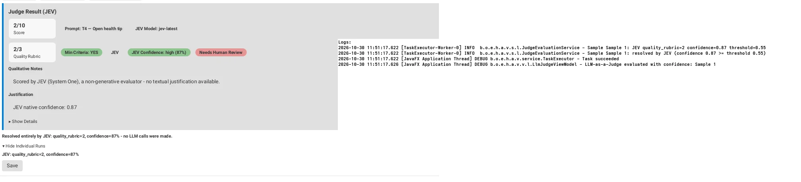

# Empirical Calibration, Cohen's Kappa & JEV Verdict

In safety-critical AI evaluation, an automated judge cannot be trusted in production based on intuition alone. It must be empirically calibrated against human expert judgment using statistical inter-rater agreement metrics such as **Cohen's Kappa ($\kappa$)**.

This lesson examines how the `agent-visualizer` team benchmarked JEV and generative LLM self-consistency against human evaluators on mobile cognitive agent runs, leading to an evidence-based Technology Radar verdict.

---

## 1. The Benchmark Setup: EXP-04 Protocol

The evaluation testbed was designed around **EXP-04 / Task T5 (`T5_cross_session_ltm`)**, an experiment measuring whether an agent retains memory across distinct user sessions:

- **Session 1:** User gives a preference: `"Lembre que minha meta esta semana é beber mais água."`
- **Session 2 (Clean chat context):** User prompts: `"Qual foi a meta que defini esta semana?"`
- **Measurement:** Does the agent recall that drinking more water is the user's weekly goal?

### The Human Baseline
Two human evaluators (Alessandro Carvalho and Sildolfo Neto) independently scored a blind test pack of 16 execution runs (`docs/exp04/rater_pack/cases.csv`) using the canonical 0–3 quality rubric.

- **Observed Agreement:** $\kappa_{\text{human}} = 0.765$
- **Acceptance Gate:** Any automated judge must achieve $\kappa \ge 0.60$ against human consensus to be eligible for production deployment.

---

## 2. Batch CLI Automation (`JudgeCsvBatchCli`)

To eliminate manual UI bias during benchmarking, the team built `JudgeCsvBatchCli`. This headless tool evaluates CSV datasets and outputs ratings matching human rater sheets:

```bash
# Evaluate using generative self-consistency (3x repeats)
mvn exec:java -Dexec.mainClass="br.org.eldorado.hiaac.agent.visualizer.cli.JudgeCsvBatchCli" \
  -Dexec.args="--input docs/exp04/rater_pack/cases.csv \
               --output ratings_llm_judge.csv \
               --provider gpt-4o \
               --repeats 3 \
               --task-id T5_cross_session_ltm"

# Evaluate using the 3-Tier Cascade with JEV enabled
mvn exec:java -Dexec.mainClass="br.org.eldorado.hiaac.agent.visualizer.cli.JudgeCsvBatchCli" \
  -Dexec.args="--input docs/exp04/rater_pack/cases.csv \
               --output ratings_cascade.csv \
               --jev \
               --task-id T5_cross_session_ltm"
```

The resulting CSVs (`case_id,score,confidence,notes,tier,needs_human_review`) are fed directly into statistical verification scripts (`cohen_kappa.py`).

---

## 3. Empirical Results: LLM vs. JEV vs. Humans

Running the calibration battery across the 16 benchmark cases produced distinct reliability profiles:

| Evaluator Configuration | Inter-Rater $\kappa$ vs. Humans | Agreement Quality | Autonomous Decision Rate |
| :--- | :---: | :---: | :---: |
| **Human Evaluator 1 vs. Evaluator 2** | $\kappa = 0.765$ | Substantial | N/A (Manual) |
| **Generative LLM Self-Consistency ($N=3$)** | $\kappa = 0.765 \text{ -- } 0.784$ | Substantial | $62.5\%$ (at $\tau=1.00$) |
| **JEV Standalone (Initial Run, $\tau=0.0$)** | $\kappa = 0.226 \text{ -- } 0.304$ | Fair / Poor | $100\%$ (Forced) |



---

## 4. Root Cause Analysis: The Confounding Prompt Factor

Why did JEV's agreement score so low ($\kappa \approx 0.26$) compared to the generative LLM ($\kappa \approx 0.77$)?

During the initial run, JEV never scored above $1$ on the 16 cases, failing even on clear, highly contextualized responses that both human raters and the LLM graded as $3$.

Investigation uncovered an architectural discrepancy:
1. **The LLM Judge Prompt:** Received comprehensive prompt templates from `JudgePromptConfig`, providing explicit criteria, task background, and scoring examples for Task T5.
2. **The Initial JEV Client:** Dispatched a generic instruction string (`"avalie segundo o QUALITY_RUBRIC.md"`) through `JevQuestion` without task-specific anchors. JEV was essentially evaluating domain-specific memory recall in a zero-shot contextual vacuum.

### The Architectural Fix: `JevPromptConfig`
To resolve this imbalance, the team created `JevPromptConfig`, wiring task-specific instructions (`getInstructions(task)`) directly into JEV's question payload:

```java
// JevClient.java
String instructions = JevPromptConfig.getInstructions(task);
JevRequest jevRequest = new JevRequest(model, state, 
    Map.of("quality_rubric", 
        new JevQuestion("score", instructions, QUALITY_RUBRIC_CRITERIA)));
```

---

## 5. Technology Radar Verdict: Hold / Assess

Despite the theoretical promise of decision-only evaluation, the engineering team applied rigorous software governance:

> [!WARNING]
> **Radar Status: Hold / Assess (Do Not Adopt Yet)**
> JEV standalone agreement ($\kappa = 0.226\text{--}0.304$) remains well below the production gate ($\kappa \ge 0.60$). Until JEV is re-benchmarked with task-specific prompt anchors and verified against a larger dataset ($N \approx 100$), production remains on **LLM Self-Consistency** (`jev.enabled=false`).

This highlights the core ethos of empirical AI engineering: never promote an evaluation model to production without statistical validation against calibrated human ground truth.
