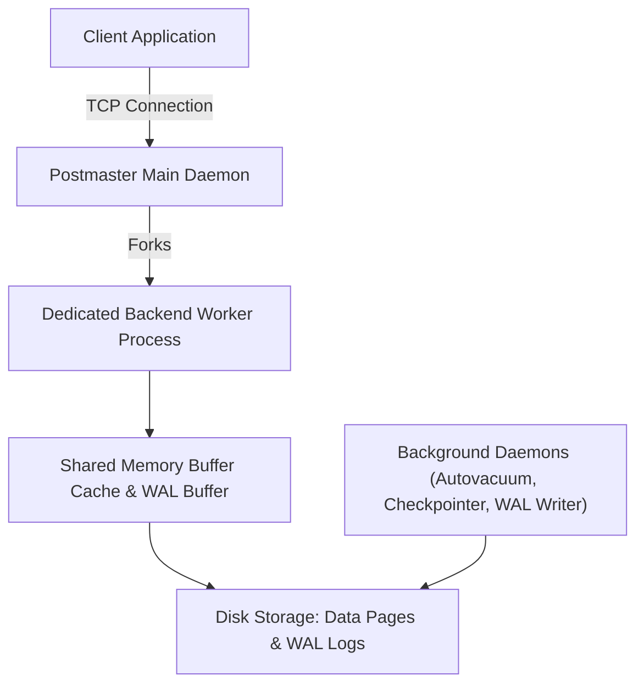

# What is PostgreSQL? The Object-Relational Database Engine

PostgreSQL (pronounced *post-gres-Q-L*, often called simply **Postgres**) is an open-source, enterprise-grade object-relational database management system (ORDBMS). Backed by more than 35 years of active development coordinated by the PostgreSQL Global Development Group, it is widely celebrated for its reliability, data integrity, SQL compliance, and unparalleled extensibility.

PostgreSQL powers high-throughput, mission-critical infrastructure across modern tech giants and scientific organizations, including Reddit, Instagram, TripAdvisor, OpenAI, and the International Space Station.

---

## What Makes PostgreSQL "Object-Relational"?

Traditional Relational Database Management Systems (RDBMS) like MySQL or SQLite structure data strictly in relational tables composed of primitive scalar types (`INT`, `VARCHAR`, `BOOLEAN`).

PostgreSQL was designed from its inception at UC Berkeley to be an **Object-Relational** system (ORDBMS), bridging the gap between relational integrity and object-oriented modeling:

1. **User-Defined Data Types:** Beyond primitive types, engineers can define custom composite types, ranges, domains, and enumerated types directly in the catalog.
2. **Table Inheritance:** A table can inherit attributes and constraints from one or more parent tables, enabling polymorphic queries.
3. **Function & Operator Overloading:** Custom functions and operators can be created and overloaded based on argument types.
4. **Rich Complex Types:** Native support for multidimensional arrays, JSON/JSONB, XML, geometric coordinates, and key-value stores.

```sql
-- Creating a custom composite type
CREATE TYPE coordinate_point AS (
    latitude  NUMERIC(9, 6),
    longitude NUMERIC(9, 6)
);

-- Using the type within a relational table
CREATE TABLE telemetry_log (
    event_id    BIGSERIAL PRIMARY KEY,
    location    coordinate_point NOT NULL,
    recorded_at TIMESTAMPTZ DEFAULT clock_timestamp()
);
```

---

## Core Process and Memory Architecture

PostgreSQL uses a multi-process architecture (rather than a multi-threaded model). Each client connection is handled by its own dedicated backend worker process forked by the master postmaster daemon.

```text
+-------------------------------------------------------------------------+
|                        PostgreSQL Server Instance                       |
|                                                                         |
|  +--------------------+                     +------------------------+  |
|  | Postmaster Process | <-- Connect / Fork  | Client Application     |  |
|  +---------+----------+                     +-----------+------------+  |
|            |                                            |               |
|            v                                            v               |
|  +--------------------+                     +------------------------+  |
|  | Backend Process 1  |                     | Backend Process 2      |  |
|  +---------+----------+                     +-----------+------------+  |
|            |                                            |               |
|            +--------------------+-----------------------+               |
|                                 |                                       |
|                                 v                                       |
|  +-------------------------------------------------------------------+  |
|  |                        Shared Memory Area                         |  |
|  |  +------------------------------+  +---------------------------+  |  |
|  |  | Shared Buffer Pool (Cache)   |  | WAL Buffers               |  |  |
|  |  +------------------------------+  +---------------------------+  |  |
|  |  | Lock Table & Process State   |  | Free Space Map (FSM)      |  |  |
|  |  +------------------------------+  +---------------------------+  |  |
|  +-------------------------------------------------------------------+  |
|            |                                            |               |
|            v                                            v               |
|  +--------------------+                     +------------------------+  |
|  | Checkpointer &     |                     | WAL Writer, BgWriter,  |  |
|  | Background Writers |                     | Autovacuum Daemon      |  |
|  +---------+----------+                     +-----------+------------+  |
+------------|--------------------------------------------|---------------+
             |                                            |
             v                                            v
+-------------------------------------------------------------------------+
|                              Disk Storage                               |
|   Heap Data Files (Pages)        Write-Ahead Log (WAL Segments)         |
+-------------------------------------------------------------------------+
```



### Key Architectural Elements:
- **Postmaster (Supervisor Daemon):** Listens on port 5432, authenticates incoming connections, and forks a dedicated backend process for each client.
- **Shared Memory:**
  - **Shared Buffers:** Cache for table and index data pages read from disk (default page size is 8KB).
  - **WAL Buffers:** Temporary holding zone for Write-Ahead Log records before flushing to disk.
- **Dedicated Backend Process:** Executes queries, plans execution trees, manages per-session sorting and hashing memory (`work_mem`).
- **Utility Processes:** Checkpointer, Background Writer (`bgwriter`), WAL Writer, Autovacuum Launcher, and Stats Collector.

---

## The "Swiss Army Knife" of Databases

Developers frequently describe PostgreSQL as the **Swiss Army Knife** of data stores. While specialized engines excel in isolated niches, PostgreSQL provides production-ready implementations across multiple paradigms:

| Workload / Model | Specialized Tool | PostgreSQL Equivalent |
| :--- | :--- | :--- |
| **Relational (ACID)** | Oracle, MySQL, SQL Server | Core SQL engine with standard MVCC |
| **Document Store** | MongoDB, Couchbase | `JSONB` with GIN indexing and containment |
| **Geospatial (GIS)** | ArcGIS, MongoDB Spatial | `PostGIS` extension (industry gold standard) |
| **Key-Value Store** | Redis | `hstore` extension or key-value unlogged tables |
| **Full-Text Search** | Elasticsearch, Solr | `tsvector`, `tsquery`, GiST/GIN dictionaries |
| **Time-Series Data** | InfluxDB | Declarative partitioning or TimescaleDB |
| **Message Queue** | RabbitMQ | `SELECT ... FOR UPDATE SKIP LOCKED` / `LISTEN/NOTIFY` |

PostgreSQL may not match an in-memory cache like Redis in raw microsecond latencies, or beat a dedicated petabyte cluster like ClickHouse in real-time OLAP aggregation. However, it delivers 80–90% of those capabilities **inside a single operational database**, eliminating distributed synchronization bugs and multi-datastore operational overhead.

---

## Strict ACID Compliance & Data Integrity

Data integrity is the non-negotiable core of PostgreSQL:

- **Atomicity:** Transactions either succeed completely or roll back cleanly without leaving orphan modifications.
- **Consistency:** Enforced through declarative constraints (Foreign Keys, Unique, Check, Exclusion constraints) and strict transaction boundaries.
- **Isolation:** Implemented via Multiversion Concurrency Control (MVCC), preventing dirty reads and non-repeatable reads without locking read queries.
- **Durability:** Guaranteed by Write-Ahead Logging (WAL). Even upon catastrophic operating system crash or power outage, committed transactions are restored from WAL segments during reboot.
