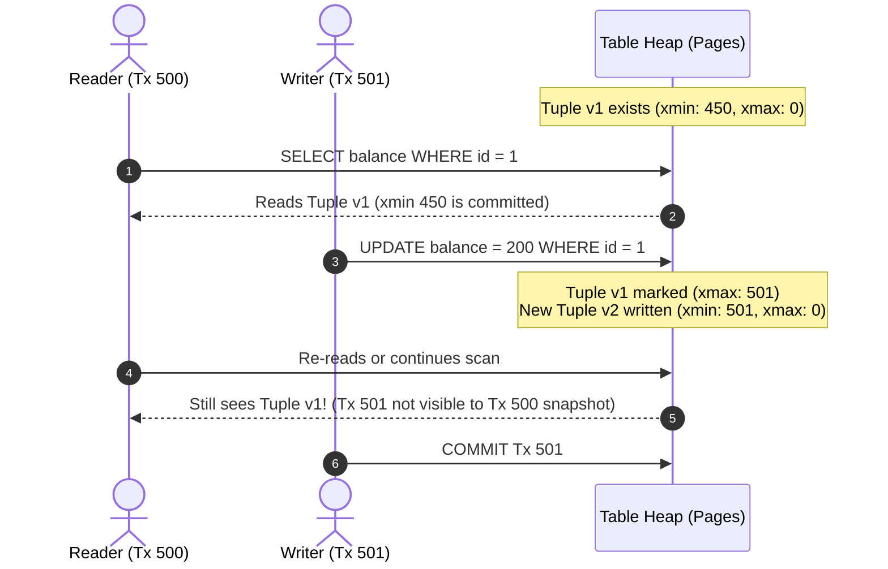

# MVCC, Concurrency & Transaction Isolation

High-throughput systems cannot afford to let reader queries lock out writer queries, or let writers block concurrent readers. PostgreSQL resolves this challenge through **Multiversion Concurrency Control (MVCC)**.

The core philosophy of MVCC is simple: **readers never block writers, and writers never block readers**.

---

## How MVCC Works Under the Hood

Unlike database engines that achieve isolation by acquiring read/write locks on entire tables or rows, PostgreSQL creates a new physical version (called a **tuple**) every time a row is inserted or updated.

Every physical table row on disk contains hidden system columns that establish its temporal visibility:

| Hidden Field | Meaning | Description |
| :--- | :--- | :--- |
| `xmin` | Creation Transaction ID | The ID of the transaction (`xid`) that inserted this version of the row. |
| `xmax` | Deletion Transaction ID | The ID of the transaction that updated or deleted this row (0 if still active). |
| `ctid` | Tuple Physical Identifier | A tuple pointer consisting of `(block_number, tuple_offset_in_block)`. |

```text
Row Creation (INSERT):
+-----------------------------------------------------+
| ctid: (0, 1)  | xmin: 501 | xmax: 0   | balance: 100| (Visible to Tx >= 501)
+-----------------------------------------------------+

Row Modification (UPDATE balance = 150 in Tx 502):
+-----------------------------------------------------+
| ctid: (0, 1)  | xmin: 501 | xmax: 502 | balance: 100| (Old tuple: Dead after 502 commits)
+-----------------------------------------------------+
| ctid: (0, 2)  | xmin: 502 | xmax: 0   | balance: 150| (New active tuple)
+-----------------------------------------------------+

Row Removal (DELETE in Tx 503):
+-----------------------------------------------------+
| ctid: (0, 2)  | xmin: 502 | xmax: 503 | balance: 150| (Marked dead for Tx > 503)
+-----------------------------------------------------+
```



When a transaction executes a query, it operates with a **Snapshot**—a point-in-time view of running, committed, and aborted transactions. The database engine filters each physical tuple by evaluating its `xmin` and `xmax` against this snapshot.

---

## Write-Ahead Logging (WAL) and Durability

PostgreSQL guarantees Durability via **Write-Ahead Logging (WAL)**:

1. Before any data page is modified in the buffer cache or written to disk, an append-only log record describing the delta is written and flushed to the WAL segment file.
2. In the event of a sudden server crash or power failure, PostgreSQL replays the WAL records starting from the last successful **Checkpoint** during startup, reconstructing all committed state.
3. WAL is the core mechanism enabling:
   - **Crash Recovery:** Guaranteed recovery to a consistent transactional state.
   - **Point-in-Time Recovery (PITR):** Restoring a base backup and rolling forward to an exact millisecond.
   - **Streaming Replication:** Streaming WAL bytes over the network to standbys.

---

## Table Bloat & The Vacuuming Process

Because updates and deletes do not overwrite data in place, obsolete rows accumulate over time as **dead tuples**. If left unattended, tables and indexes inflate in disk size (**table bloat**), slowing down sequential scans and consuming storage.

### The Autovacuum Daemon
PostgreSQL includes a background `autovacuum` daemon that automatically:
- Scans table pages for dead tuples that are no longer visible to any active snapshot.
- Marks that page space as free inside the **Free Space Map (FSM)** so future `INSERT` queries can reuse it.
- Updates query planner statistics (`ANALYZE`).
- Freezes old transaction IDs to prevent **Transaction ID Wraparound** (a condition where 32-bit transaction IDs recycle and risk data invisibility).

```sql
-- Manually reclaiming space without locking the table:
VACUUM VERBOSE my_large_table;

-- Full table rewrite (reclaims disk space to OS, takes an EXCLUSIVE lock):
VACUUM FULL my_large_table;
```

---

## Transaction Isolation Levels

PostgreSQL supports three ANSI SQL transaction isolation levels:

| Isolation Level | Dirty Read | Non-Repeatable Read | Phantom Read | Serialization Anomaly |
| :--- | :--- | :--- | :--- | :--- |
| **Read Committed** (Default) | Not Possible | Possible | Possible | Possible |
| **Repeatable Read** | Not Possible | Not Possible | Not Possible | Possible |
| **Serializable (SSI)** | Not Possible | Not Possible | Not Possible | Not Possible |

```sql
-- Starting a repeatable read transaction
BEGIN TRANSACTION ISOLATION LEVEL REPEATABLE READ;

SELECT current_balance FROM accounts WHERE user_id = 42;
-- Repeated reads within this transaction will always return the exact same snapshot
-- even if other transactions commit updates concurrently.

COMMIT;
```

PostgreSQL implements true **Serializable Snapshot Isolation (SSI)**, which detects dependency cycles among transactions at runtime and safely aborts conflicting transactions without requiring table-level read locks.
