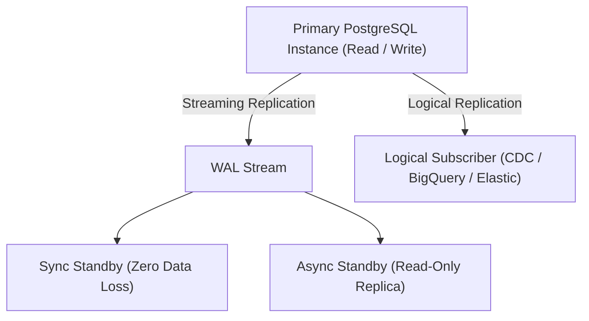

# Scaling, Replication & Production Deployment

Scaling a production PostgreSQL cluster requires combining connection pooling, read replication, table partitioning, and reliable disaster recovery mechanisms.

---

## Connection Pooling: Overcoming the Process Model

Because PostgreSQL forks a separate OS process for every incoming connection, maintaining thousands of open client connections consumes significant RAM (roughly 2–10 MB per backend process) and introduces heavy context-switching overhead on CPU cores.

```text
+-----------------------+
|  Application Pods     |  (5,000+ app client connections)
+-----------+-----------+
            |
            v
+-----------------------+
|  Connection Pooler    |  (PgBouncer / pgcat / Odyssey)
|  - Transaction Mode   |
+-----------+-----------+
            |
            v              (Maintains 50–100 persistent connections)
+-----------------------+
|  PostgreSQL Database  |
+-----------------------+
```

### Connection Pool Modes in PgBouncer:
- **Session Pooling:** A server connection is dedicated to the client until it disconnects.
- **Transaction Pooling (Recommended for Web APIs):** A server connection is returned to the pool as soon as the client's current transaction commits. This allows 100 backend database connections to effortlessly serve 10,000 active web microservices.
- **Statement Pooling:** Multi-statement transactions are forbidden. Useful only for simple auto-commit read queries.

---

## Declarative Table Partitioning

When a table grows past tens of millions of rows, sequential scans slow down and index sizes exceed available RAM. PostgreSQL provides native **declarative partitioning**:

```sql
-- Create parent partitioned table by range
CREATE TABLE order_audit_log (
    log_id      BIGSERIAL,
    order_id    BIGINT NOT NULL,
    payload     JSONB,
    created_at  TIMESTAMPTZ NOT NULL
) PARTITION BY RANGE (created_at);

-- Create monthly partition tables
CREATE TABLE order_audit_2025_01 PARTITION OF order_audit_log
    FOR VALUES FROM ('2025-01-01') TO ('2025-02-01');

CREATE TABLE order_audit_2025_02 PARTITION OF order_audit_log
    FOR VALUES FROM ('2025-02-01') TO ('2025-03-01');

-- PostgreSQL automatically performs "Partition Pruning":
-- Queries filtering on created_at scan ONLY the matching child table partition.
```

PostgreSQL supports:
- **Range Partitioning:** (e.g., dates, numeric ranges)
- **List Partitioning:** (e.g., country codes, department status)
- **Hash Partitioning:** (e.g., hashing user IDs across $N$ shards)

---

## High Availability & Replication Topologies



### 1. Physical Streaming Replication
The primary server continuously streams binary WAL records over the network to one or more standby instances:
- **Asynchronous:** The primary commits transactions immediately without waiting for replicas to confirm receipt. Delivers peak write performance with minor risk of data loss during primary failover.
- **Synchronous:** The primary blocks until at least one replica confirms WAL records have been written to disk. Eliminates data loss (RPO = 0) at the cost of higher transaction latency.

### 2. Logical Replication & CDC
Physical replication duplicates the entire database cluster byte-for-byte. In contrast, **Logical Replication** broadcasts table-level row changes (`INSERT`, `UPDATE`, `DELETE`) decoded from WAL:
- Selectively replicate individual tables to external data warehouses.
- Stream events to Apache Kafka or Debezium for Change Data Capture (CDC).
- Perform zero-downtime major version upgrades between different PostgreSQL versions.

---

## Disaster Recovery & Backups

A resilient backup strategy combines two tiers:

1. **Logical Backups (`pg_dump` / `pg_restore`):** Generates plain SQL text or compressed archive files. Ideal for migrations, smaller databases, and inspecting schema structures.
2. **Physical Backups & WAL Archiving (`pgBackRest` / `WAL-G`):** Takes point-in-time filesystem snapshots of all database files and continuously archives completed WAL segments to cloud storage (e.g., S3).
   - Allows **Point-In-Time Recovery (PITR)**: Recover the cluster to any exact second in the past (e.g., `"2025-10-15 14:23:01 UTC"`), undoing accidental `DROP TABLE` catastrophes.

---

## Running PostgreSQL in Production

### Deployment Models:
- **Cloud-Managed Services:** AWS RDS, Google Cloud SQL, Azure Database for PostgreSQL, Supabase, Neon. Ideal for minimizing administrative toil.
- **Kubernetes Operators:** **CloudNativePG** and Crunchy Data PGO provide automated failover, self-healing, rolling minor upgrades, and scheduled backups directly inside Kubernetes clusters.
- **Bare-Metal / Virtual Machines:** Provides maximum I/O performance and direct memory tuning for high-frequency financial or telemetry workloads.
